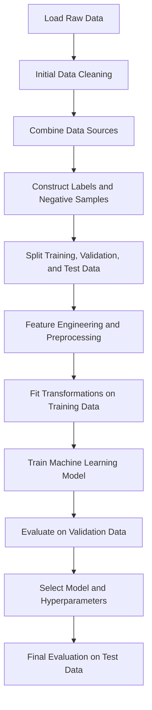

In the preceding sections, we introduced the application of machine learning to recommender systems and examined two fundamental supervised learning algorithms: **Linear Regression** and **Logistic Regression**.

We learned that these models require input features describing users, items, and the potential interactions between them. The models use these features to predict numerical ratings or the probability of an interaction.

Consider an e-commerce dataset containing information about users and products.

User-related attributes might include age, gender, occupation, and personal interests. Product-related attributes might include color, material, historical price changes, average ratings, and the number of users currently viewing a product.

Such a dataset raises several important questions:

- How should these attributes be incorporated into a machine learning model?
- Which features contain useful information for predicting user preferences?
- Are the available features sufficient to capture the relationships between users and items?
- How should raw attributes be transformed before model training?

Answering these questions requires two closely related processes: **Feature Engineering** and **Data Preprocessing**.

## 1. The Role of Features in Machine Learning Models

The performance of a machine learning model depends heavily on the quality, relevance, and representation of its input features.

Even sophisticated algorithms may produce inaccurate predictions when trained on irrelevant, incomplete, noisy, or incorrectly processed data.

This principle is commonly summarized as:

> Garbage In, Garbage Out (GIGO).

In other words, the quality of the predictions produced by a model is fundamentally constrained by the quality of the information provided to it.

Preparing data for machine learning generally involves two complementary processes.

### Feature Engineering

**Feature Engineering** is the process of selecting, extracting, transforming, or creating informative features from available data.

It combines statistical analysis, domain knowledge, and experimentation to represent information in a form that machine learning algorithms can use effectively.

For example, a raw interaction dataset may contain thousands of individual ratings for each user.

Instead of supplying only these raw interactions, we might calculate a user's average rating, rating frequency, or preference for particular product categories.

These derived quantities can help a model identify behavioral patterns.

The objective of feature engineering is to make useful relationships in the data more accessible to the learning algorithm.

### Data Preprocessing

**Data Preprocessing** consists of the operations required to clean, transform, and standardize data before model training.

Common preprocessing operations include:

- Handling missing values.
- Scaling numerical features.
- Encoding categorical variables.
- Identifying and correcting invalid observations.
- Managing imbalanced datasets.

Feature engineering and preprocessing are closely connected, and their operations may overlap.

For example, converting a categorical variable into a numerical representation can be considered both a preprocessing operation and a form of feature transformation.

Together, these processes form the foundation of data preparation for machine learning-based recommender systems.

## 2. Data Sources in Recommender Systems

In earlier chapters, particularly *An Overview of Matrix Factorization*, we studied **User–Item Interaction Matrices**.

These matrices represent relationships between users and items, such as ratings, clicks, or purchases.

However, interaction matrices capture only part of the information available to a recommendation platform.

A machine learning-based recommender can incorporate additional data describing users, items, and the circumstances under which interactions occur.

These additional sources may improve predictive performance, particularly when interaction histories are sparse or when user preferences depend on contextual information.

Four major categories of recommendation data are especially important.

### 2.1. Interaction Data

**Interaction Data** describes the observed relationships between users and items.

Examples include:

- Ratings.
- Clicks.
- Purchases.
- Views.
- Other forms of user engagement.

A typical interaction dataset may contain:

| Column | Description |
|---|---|
| `user_id` | Unique identifier of the user |
| `item_id` | Unique identifier of the item |
| `rating` | Numerical rating assigned by the user |
| `interaction_type` | Type of interaction, such as click or purchase |
| `timestamp` | Time at which the interaction occurred |

Interaction data provides direct evidence of user behavior and remains one of the most important information sources for recommender systems.

### 2.2. User Data

**User Data** describes characteristics of individual users.

It may include several categories of information.

**Demographic Information**

- Age.
- Gender.
- Geographic location.
- Language.

**Profile Information**

- Explicitly stated interests.
- Occupation.
- Marital status.

**Platform Activity History**

- Registration date.
- Number of login sessions.
- Total time spent on the platform.

These attributes can help recommendation models identify differences between users beyond their observed interactions.

For example, two users may have similar rating histories but different preferences under particular contextual conditions.

User attributes can provide additional predictive signals, although their inclusion should be justified by relevance, privacy requirements, and fairness considerations.

### 2.3. Item Data

**Item Data** describes the characteristics of the products, movies, books, or other entities being recommended.

It can include structured metadata, textual information, and multimedia content.

**Descriptive Metadata**

- Title.
- Description.
- Categories and genres.
- Actors, directors, or authors.
- Brand.
- Price.
- Release year.
- Publisher.

**Textual Content**

- Reviews.
- Song lyrics.
- News articles.
- Product descriptions.

**Multimedia Content**

- Movie posters.
- Product images.
- Videos.
- Music and other audio content.

Item information is particularly useful for content-based recommendation and for recommending new items that have little or no interaction history.

For example, a newly released movie may have no user ratings, but its genre, cast, director, and description may provide enough information to estimate its relevance to certain users.

### 2.4. Contextual Data

**Contextual Data** describes the circumstances under which an interaction occurs.

User preferences may vary depending on time, location, device, or how an item was discovered.

Important contextual attributes include:

**Temporal Context**

- Hour of the day.
- Day of the week.
- Month.
- Season.

**Location Context**

- The user's geographic location at the time of interaction.

**Device Context**

- Mobile phone.
- Desktop computer.
- Tablet.

**Access or Discovery Context**

- Whether the user searched for the item.
- Whether the item appeared on the homepage.
- Whether the user reached the item through a previous recommendation.

These variables can help capture patterns that are not explained by user and item characteristics alone.

For example, a user may prefer short videos during a work break but longer content in the evening.

Contextual features allow the model to distinguish between these situations.

## 3. Feature Engineering

Feature engineering is one of the most important stages in developing machine learning-based recommender systems.

After identifying the available data sources, we must determine which information should be provided to the model and how it should be represented.

Feature engineering can be divided into three major activities:

1. Feature Selection.
2. Feature Extraction.
3. Feature Creation.

Although these activities are closely related, each addresses a different problem.

### 3.1. Feature Selection

**Feature Selection** is the process of identifying which existing features are useful for predicting the target variable.

A dataset may contain dozens or hundreds of columns, but not every column necessarily contributes useful predictive information.

Some features may be irrelevant, redundant, noisy, or strongly correlated with other features.

Including such variables can increase computational cost and, in some circumstances, reduce generalization performance.

#### Correlation-Based Feature Selection

For linear models, correlation analysis can provide an initial indication of relationships between numerical features and the target variable.

The Pearson correlation coefficient measures the strength and direction of a linear relationship between two variables.

It is defined as:

$$
r_{X,Y}=\frac{\operatorname{Cov}(X,Y)}{\sigma_{X}\sigma_{Y}}
$$

Where:

- $\operatorname{Cov}(X,Y)$ is the covariance between $X$ and $Y$.
- $\sigma_{X}$ and $\sigma_{Y}$ are their standard deviations.

The correlation coefficient lies between -1 and 1.

- A value close to 1 indicates a strong positive linear relationship.
- A value close to -1 indicates a strong negative linear relationship.
- A value close to 0 indicates little or no linear relationship.

Features with strong correlations with the target may be useful candidates for a linear prediction model.

However, correlation alone does not establish predictive usefulness.

A feature may have a weak individual correlation with the target but become valuable when combined with other features.

Similarly, a high correlation does not guarantee that the feature will improve performance on unseen data.

#### Model-Based Feature Selection

Many relationships in recommendation datasets are nonlinear or depend on interactions between several variables.

Therefore, feature selection should not rely exclusively on linear correlation.

An alternative is to train models using different feature subsets and compare their validation performance.

For example:

1. Train a model using all available features.
2. Train another model using a selected subset.
3. Compare their predictive performance.
4. Retain features that contribute meaningfully to generalization.

This approach can reveal which combinations of features are most useful.

In the previous section on logistic regression, we inspected the learned coefficients and observed that some features had larger coefficients than others.

Coefficient analysis can provide useful information, but raw coefficient magnitudes should not be interpreted as direct measures of importance when features have different scales.

Model-based feature selection should therefore consider feature scaling, regularization, and validation performance.

### 3.2. Feature Extraction

**Feature Extraction** involves deriving informative representations from existing data.

This is particularly useful when the original variables do not express the relationships required by the learning algorithm.

For example, suppose the relationship between an input feature $x$ and a target variable $y$ follows a quadratic pattern.

A simple linear model:

$$
\hat{y}=\beta_{0}+\beta_{1}x
$$

cannot represent this relationship exactly.

However, we can introduce a new feature:

$$
x_{2}=x^{2}
$$

The model then becomes:

$$
\hat{y}=\beta_{0}+\beta_{1}x+\beta_{2}x^{2}
$$

Although the resulting function is nonlinear in the original input variable, it remains linear in the model coefficients.

This allows linear regression to represent a broader range of relationships through engineered features.

Common feature extraction operations include:

- Squaring or raising numerical variables to higher powers.
- Multiplying two numerical variables.
- Calculating averages.
- Computing statistical summaries.
- Deriving differences or ratios.

For example, geographic coordinates may be transformed into features representing distance, relative location, or interactions between latitude and longitude.

Multiplying latitude and longitude can be used as an interaction feature in some models, but it is not universally useful. Geographic distance or other spatial transformations may provide more meaningful representations depending on the application.

The appropriate transformation should be selected through domain knowledge and empirical evaluation.

### 3.3. Feature Creation

Sometimes the existing dataset does not contain enough information to construct useful predictive features.

Even after feature selection and extraction, model performance may remain unsatisfactory.

In such cases, it may be necessary to collect additional information and introduce entirely new features.

This process is called **Feature Creation**.

For example, an e-commerce recommendation dataset may initially contain only user IDs, item IDs, and purchase histories.

If these variables are insufficient, the system might collect additional information such as:

- Product categories.
- Product descriptions.
- Historical price changes.
- User preference selections.
- Contextual interaction information.

These new data sources can provide information that was previously unavailable.

However, collecting additional data is often expensive and introduces operational requirements related to storage, integration, quality control, and privacy.

Feature creation should therefore be guided by a clear understanding of which missing information could improve the prediction task.

## 4. Feature Engineering Techniques

We now examine several practical categories of features that can be constructed for recommendation models.

These examples provide a foundation for designing informative feature representations in real-world systems.

### 4.1. Interaction-Based Features

Interaction-based features are derived from historical user behavior and item interactions.

They summarize patterns that may be useful for predicting future preferences.

#### User Statistical Features

**User Average Rating**

The average rating assigned by a user can indicate their general rating tendency.

```python
df.groupby('user_id')['rating'].transform('mean')
```

**User Rating Count**

The number of ratings submitted by a user can represent their activity level.

```python
df.groupby('user_id')['rating'].transform('count')
```

**User Rating Standard Deviation**

The standard deviation of a user's ratings describes how much their ratings vary.

```python
df.groupby('user_id')['rating'].transform('std')
```

For example, a user who assigns nearly identical ratings to all items has a lower rating standard deviation than a user who frequently assigns both very high and very low ratings.

#### Item Statistical Features

**Item Average Rating**

The average rating received by an item can serve as a measure of its historical reception.

```python
df.groupby('item_id')['rating'].transform('mean')
```

**Item Rating Count**

The number of ratings received by an item provides information about its interaction volume.

```python
df.groupby('item_id')['rating'].transform('count')
```

**Item Rating Standard Deviation**

The standard deviation of item ratings measures disagreement or variation among users' evaluations.

```python
df.groupby('item_id')['rating'].transform('std')
```

An item with highly variable ratings may appeal strongly to some users while receiving unfavorable evaluations from others.

#### Combined Statistical Features

New features can also be constructed by combining user and item statistics.

**Difference Between User Average Rating and Global Average Rating**

```python
user_avg_rating - global_average
```

This feature measures whether a user tends to assign ratings above or below the overall average.

**Product of User and Item Average Ratings**

```python
user_avg_rating * item_avg_rating
```

This feature represents an interaction between the user's rating tendency and the item's average rating.

Such combinations may help a model capture relationships that are not represented by the original features independently.

#### Presence or Absence Features

Binary features can indicate whether a particular historical behavior has occurred.

For example:

> Has the user previously interacted with items belonging to category X?

This feature requires both item metadata and the user's historical interactions.

It can be represented as:

$$
x_{u,c}=\begin{cases}1 & \text{if user }u\text{ has interacted with category }c\\0 & \text{otherwise}\end{cases}
$$

Such features can be particularly useful for identifying category-level preferences.

**Important:** Interaction-derived statistics must be computed without using future interactions or held-out target values. Otherwise, they may introduce data leakage and produce unrealistically optimistic evaluation results.

### 4.2. User and Item Side Features

Side features are obtained directly from user profiles or item metadata.

They can be divided into numerical and categorical features.

#### Numerical Features

Examples include:

- User age.
- Product price.
- Item release year.

Numerical features can often be supplied directly to machine learning algorithms.

However, their scales may differ substantially, making normalization or standardization necessary for certain models.

#### Categorical Features

Examples include:

- Gender.
- Geographic region.
- Movie genre.
- Product brand.
- Director.

Categorical variables represent discrete categories rather than numerical quantities.

Even when categories are stored as integers, those integers may function only as identifiers and may not have meaningful numerical relationships.

Therefore, categorical variables generally require appropriate encoding before they can be used by standard machine learning algorithms.

Common techniques include:

**One-Hot Encoding**

Each category is represented using a separate binary indicator.

**Label Encoding**

Categories are assigned integer identifiers.

However, assigning integers to nominal categories can introduce artificial ordering when used with algorithms that interpret the values numerically.

For such models, one-hot encoding or another suitable categorical representation is generally preferable.

Encoding also introduces practical challenges.

For example, a categorical feature containing thousands of unique values can produce a large number of columns when one-hot encoded.

Sparse representations can help reduce memory consumption in these situations.

### 4.3. Contextual Features

Contextual features describe the conditions under which a user–item interaction occurs.

One common source of contextual information is the interaction timestamp.

For example, a timestamp can be used to extract several temporal features.

**Hour of the Day**

```python
df['timestamp'].dt.hour
```

**Day of the Week**

```python
df['timestamp'].dt.dayofweek
```

**Month**

```python
df['timestamp'].dt.month
```

These features may reveal temporal patterns in user behavior.

For example, users may interact with different content categories on weekdays and weekends.

Temporal features can be represented as numerical or categorical variables.

One-hot encoding may be appropriate when the categories should not be interpreted as having a simple linear relationship.

For cyclic variables such as hour of day, cyclical transformations may also be useful because they preserve the relationship between the beginning and end of a cycle.

### 4.4. Cross Features

**Cross Features** are constructed by combining two or more existing features.

They allow models to capture relationships that depend on interactions between variables.

Examples include:

**Multiplication of Numerical Features**

Two numerical features can be multiplied to create an interaction term.

**Combination of Categorical Features**

For example, a new categorical feature may represent the combination of a user's gender and an item's genre.

Such features can help a model learn patterns that are specific to particular combinations of user and item characteristics.

Cross features are especially useful for linear models because they allow relationships between original variables to be represented without changing the underlying linear model architecture.

However, excessive feature crossing can produce high-dimensional representations and increase the risk of overfitting.

## 5. Data Preprocessing

After feature engineering, the resulting dataset may still require additional preparation before it can be used for model training.

Preprocessing transforms the engineered features into a consistent and suitable representation.

We will focus on three important preprocessing challenges:

1. Handling Missing Values.
2. Scaling Numerical Features.
3. Handling Imbalanced Data.

### 5.1. Handling Missing Values

Engineered features may contain missing values, commonly represented as `NaN` in Pandas.

For example, if a user has no historical ratings, their average rating cannot be calculated directly.

Similarly, an item may lack a price, release year, or other metadata.

Missing values must be handled appropriately because many machine learning algorithms cannot process them directly.

#### Identifying Missing Values

Pandas provides a convenient method for counting missing values in each column.

```python
df.isnull().sum()
```

This operation returns the number of missing observations for every feature.

#### Strategies for Handling Missing Values

**Removing Rows or Columns**

Rows or columns containing missing values may be removed when doing so does not discard an unacceptable amount of useful information.

For example, a feature with an extremely high missing-value rate may provide little practical value.

However, deleting observations can introduce bias if the missingness is related to user behavior or other important variables.

**Imputation**

Imputation replaces missing values with estimated or predefined values.

Common approaches include:

- Replacing missing values with a constant, such as `0` or `-1`.
- Replacing missing numerical values with the mean.
- Replacing missing numerical values with the median.
- Replacing missing categorical values with the mode.
- Using predictive models to estimate missing values.

The appropriate method depends on the meaning and distribution of the feature.

For example, replacing a missing user rating count with zero may be meaningful when the user has genuinely provided no ratings.

However, replacing a missing product price with zero could incorrectly imply that the product is free.

Therefore, imputation values should be selected according to the semantics of the data.

### 5.2. Scaling Numerical Features

Some machine learning algorithms are sensitive to differences in feature scale.

For example, suppose a movie recommendation dataset contains:

- Average movie rating, ranging from 1 to 5.
- Number of movie views, ranging from 0 to 20,000.

These variables operate on very different numerical scales.

Without appropriate scaling, optimization algorithms may converge inefficiently, and regularization may affect coefficients unevenly.

This is particularly relevant to linear and logistic regression models trained with numerical optimization methods.

Scaling does not inherently make a feature more predictive, but it can improve numerical stability and the behavior of scale-sensitive algorithms.

#### Standardization

**Standardization**, also called **Z-Score Normalization**, transforms a feature using its mean and standard deviation.

The formula is:

$$
z=\frac{x-\mu}{\sigma}
$$

Where:

- $x$ is the original feature value.
- $\mu$ is the feature mean.
- $\sigma$ is the feature standard deviation.

After standardization, the transformed training feature typically has a mean of approximately zero and a standard deviation of approximately one.

This transformation is commonly used with linear models and other algorithms sensitive to feature scale.

#### Min-Max Scaling

**Min-Max Scaling** transforms feature values into a specified interval, commonly from 0 to 1.

The standard formula is:

$$
x'=\frac{x-x_{\min}}{x_{\max}-x_{\min}}
$$

Where:

- $x_{\min}$ is the minimum observed value.
- $x_{\max}$ is the maximum observed value.
- $x'$ is the scaled value.

For values within the original training range, the transformed values lie between 0 and 1.

Values outside the training range may produce transformed values outside this interval unless clipping is applied.

#### Preventing Data Leakage During Scaling

Scaling parameters must be estimated using the training data only.

The correct procedure is:

1. Split the dataset into training, validation, and test sets.
2. Fit the scaler using the training features.
3. Transform the training data using the fitted scaler.
4. Apply the same transformation to validation and test data.

This prevents information from the validation or test sets from influencing the preprocessing parameters.

The same principle applies to imputation, feature selection, and other preprocessing operations that estimate statistics from data.

### 5.3. Handling Imbalanced Data

Class imbalance is a common challenge in recommendation tasks formulated as classification problems.

For example, in click prediction, the number of non-clicked impressions may be substantially larger than the number of clicked impressions.

Suppose a dataset contains 100 observations:

- 98 observations belong to the negative class.
- 2 observations belong to the positive class.

A model that always predicts the negative class would achieve:

$$
Accuracy=\frac{98}{100}=0.98
$$

Its accuracy would be 98%.

At first glance, this appears to be excellent performance.

However, the model would fail to identify every positive interaction.

Such a classifier would provide little value for a system whose objective is to identify items that users are likely to click.

Therefore, accuracy alone is often insufficient for evaluating models trained on imbalanced datasets.

#### Sampling Techniques

Sampling methods modify the class distribution in the training data.

They can be divided into two broad categories.

**Oversampling**

Oversampling increases the representation of the minority class.

Common approaches include:

- Random Oversampling.
- Synthetic Minority Over-sampling Technique (SMOTE).

Random oversampling duplicates or resamples existing minority-class observations.

SMOTE generates synthetic observations by interpolating between suitable minority-class examples.

However, SMOTE may not be appropriate for every recommendation dataset, particularly when features include high-dimensional sparse identifiers or categorical variables.

**Undersampling**

Undersampling reduces the representation of the majority class.

Common approaches include:

- Random Undersampling.
- Tomek Links-based cleaning or undersampling.

Random undersampling removes a subset of majority-class observations.

Tomek Links can help identify pairs of nearby observations belonging to different classes and are often used to clean ambiguous regions of the feature space.

The negative sampling strategy discussed in the logistic regression section can be viewed as a form of selecting a subset of the much larger population of unobserved user–item pairs.

However, unobserved interactions are not necessarily confirmed negatives, so this sampling procedure requires careful interpretation.

#### Selecting Appropriate Evaluation Metrics

For imbalanced classification problems, it is often preferable to evaluate performance using metrics such as:

- Precision.
- Recall.
- F1-Score.
- ROC-AUC.

These metrics provide information that overall accuracy may conceal.

Precision measures how frequently positive predictions are correct.

Recall measures how many actual positive observations are successfully identified.

F1-Score combines precision and recall.

ROC-AUC measures ranking discrimination across classification thresholds.

For highly imbalanced recommendation datasets, Precision–Recall curves and PR-AUC may also be particularly informative because they focus on positive-class retrieval performance.

No single metric completely resolves the challenges of class imbalance. The evaluation metric should reflect the actual recommendation objective.

#### Class Weighting

**Class Weighting** modifies the training objective by assigning different penalties to errors involving different classes.

For example, the minority class may receive a larger weight so that the model places greater emphasis on correctly identifying those observations.

Scikit-learn's logistic regression implementation supports automatic class weighting:

```python
class_weight='balanced'
```

With this option, class weights are calculated according to:

$$
w_{c}=\frac{N}{C\cdot N_{c}}
$$

Where:

- $N$ is the total number of training observations.
- $C$ is the number of classes.
- $N_{c}$ is the number of observations belonging to class $c$.

For example, suppose the positive class represents 10% of a binary training dataset.

Its weight becomes:

$$
w_{\text{positive}}=\frac{1}{2\cdot0.1}=5
$$

The negative class, representing 90% of the data, receives:

$$
w_{\text{negative}}=\frac{1}{2\cdot0.9}\approx0.556
$$

Thus, the positive class receives approximately nine times the weight of the negative class.

This increases the model's sensitivity to errors involving the minority class without changing the number of training observations.

Class weighting can also be combined with sampling methods, although the combined effects should be evaluated carefully.

### Confusion Matrix

A **Confusion Matrix** summarizes the relationship between actual class labels and predicted class labels.

For binary classification, it contains four quantities:

| | Predicted Negative | Predicted Positive |
|---|---|---|
| Actual Negative | True Negative (TN) | False Positive (FP) |
| Actual Positive | False Negative (FN) | True Positive (TP) |

These quantities provide the foundation for several important classification metrics.

- **True Positive:** The model correctly predicts a positive interaction.
- **True Negative:** The model correctly predicts a negative interaction.
- **False Positive:** The model predicts an interaction that did not occur.
- **False Negative:** The model fails to predict an interaction that occurred.

The confusion matrix is especially useful for understanding whether a classifier makes more false-positive or false-negative errors.

### Evaluating Classification Model Performance

Several evaluation metrics can be derived from the confusion matrix.

**Accuracy**

$$
Accuracy=\frac{TP+TN}{TP+TN+FP+FN}
$$

**Precision**

$$
Precision=\frac{TP}{TP+FP}
$$

**Recall**

$$
Recall=\frac{TP}{TP+FN}
$$

**F1-Score**

$$
F1=\frac{2\cdot Precision\cdot Recall}{Precision+Recall}
$$

These metrics describe different aspects of classification performance.

In recommendation systems, the relative importance of each metric depends on the application.

For example, a system that aims to avoid irrelevant recommendations may prioritize precision, while a candidate retrieval stage may prioritize recall to avoid excluding potentially relevant items.

## 6. Data Pipelines

A complete machine learning project typically involves a sequence of data preparation, model training, and evaluation operations.

This sequence is commonly called a **Data Pipeline** or **Machine Learning Pipeline**.

A well-designed pipeline ensures that data transformations are applied consistently and that the same preprocessing logic is used during training and inference.

The main stages are described below.

### 6.1. Loading Raw Data

The process begins by loading data from the available sources.

These may include:

- User–item interactions.
- User profiles.
- Item metadata.
- Contextual information.

### 6.2. Initial Data Cleaning

The raw data is inspected and cleaned.

Typical operations include:

- Removing duplicate records.
- Correcting invalid values.
- Standardizing data types.
- Handling special values.

For example, a rating value of `0` may represent missing information in a dataset where valid explicit ratings range from 1 to 5.

Such values must be interpreted according to the dataset specification rather than treated automatically as valid ratings.

### 6.3. Combining Data Sources

The cleaned datasets are joined using shared identifiers.

For example, interaction records can be combined with user and item attributes using:

- `user_id`
- `item_id`

The resulting dataset contains information about each observed user–item interaction and its associated features.

### 6.4. Negative Sampling

For binary classification tasks, negative examples may need to be constructed from unobserved interactions.

The sampling procedure should be designed according to the prediction task and the available interaction or exposure information.

### 6.5. Feature Engineering

New features are constructed from the combined dataset.

Examples include:

- User average rating.
- Item popularity.
- Historical interaction counts.
- Temporal features.
- Cross features.

### 6.6. Handling Missing Values

Missing values in raw or engineered features are identified and handled.

The chosen strategy may involve deletion, constant replacement, statistical imputation, or model-based estimation.

Any imputation parameters learned from data must be estimated using the training set only.

### 6.7. Splitting the Dataset

The dataset is divided into:

- Training set.
- Validation set.
- Test set.

The training set is used to fit model parameters.

The validation set is used for model selection and hyperparameter tuning.

The test set is reserved for evaluating the final selected model.

For recommendation tasks involving temporal interactions, chronological splitting may be preferable to random splitting because it better reflects the objective of predicting future user behavior.

### 6.8. Encoding Categorical Features

Categorical features are converted into numerical representations.

For example, One-Hot Encoding may be used to transform product categories into binary indicator columns.

The encoder must be fitted using the training data and then applied consistently to the validation and test sets.

This prevents the preprocessing procedure from learning information from held-out data.

### 6.9. Scaling Numerical Features

Numerical features are standardized or normalized when required by the selected learning algorithm.

The scaler is fitted on the training data and then used to transform all dataset partitions.

### 6.10. Final Feature and Target Preparation

The processed data is separated into:

- Feature matrix $X$.
- Target vector $\mathbf{y}$.

These structures are prepared for each dataset partition.

### 6.11. Model Training

The selected machine learning algorithm is trained using the training feature matrix and target vector.

Examples include:

- Linear Regression.
- Logistic Regression.
- Decision Trees.
- Random Forest.
- Gradient Boosting.

### 6.12. Model Validation

The trained model is evaluated using the validation set.

Validation performance is used to:

- Compare candidate models.
- Select hyperparameters.
- Identify overfitting.
- Assess the usefulness of feature engineering decisions.

### 6.13. Final Generalization Evaluation

After selecting the final model, its performance is measured using the test set.

The test set should remain independent of the model development and selection process.

This provides a more reliable estimate of how well the selected model generalizes to unseen observations.

### Example of a Machine Learning Pipeline



In practice, the order of certain operations requires careful attention.

For example, interaction-derived features must be constructed using only information available at the relevant prediction time. Similarly, statistical preprocessing operations must not use information from validation or test observations when estimating training-time parameters.

These restrictions prevent **Data Leakage**, which occurs when information unavailable during real-world prediction influences model training or evaluation.

### Automating Preprocessing with Scikit-learn

Scikit-learn provides the `sklearn.pipeline.Pipeline` class for organizing and automating sequences of preprocessing and modeling operations.

A pipeline can combine transformations such as:

- Missing-value imputation.
- Feature scaling.
- Categorical encoding.
- Model training.

This structure helps ensure that preprocessing steps are applied consistently.

It also reduces the risk of data leakage during cross-validation because transformations can be fitted independently within each training fold.

For datasets containing different feature types, `ColumnTransformer` can be used alongside `Pipeline` to apply different preprocessing operations to numerical and categorical columns.

Together, these tools provide a systematic foundation for building reproducible and maintainable machine learning workflows for recommender systems.