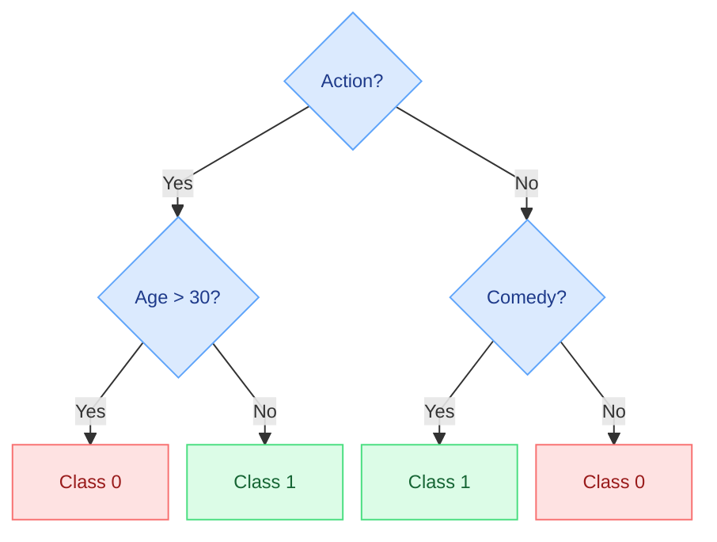
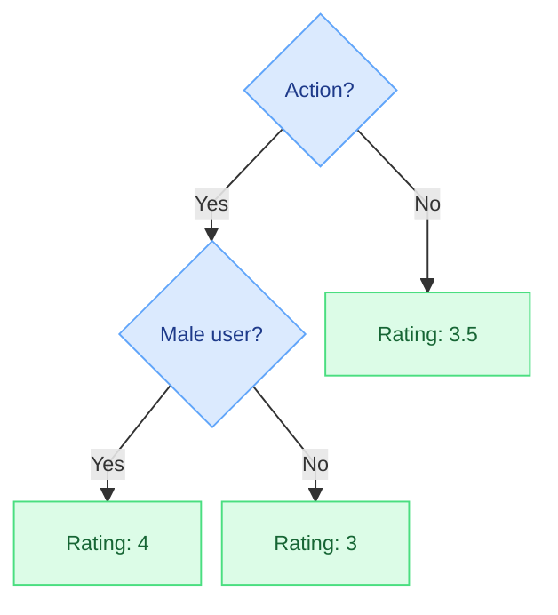
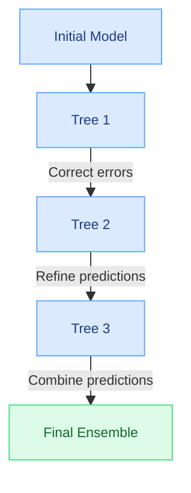

# Decision Trees and Tree-Based Methods

In the preceding sections, we studied **Linear Regression** and **Logistic Regression**, two fundamental machine learning algorithms based on linear models.

These models assume that the relationship between the input features and the target variable can be represented through a linear combination of features. Geometrically, this corresponds to a line, plane, or hyperplane in the feature space.

Although linear models are relatively simple, computationally efficient, and interpretable, they may struggle to represent the complex **nonlinear relationships** frequently encountered in real-world datasets.

For example, a user's preference for a particular movie genre may depend on their age, previous interactions, and other characteristics. These relationships may involve conditional patterns that cannot be adequately captured by a simple linear function without additional feature engineering.

A family of machine learning algorithms known as **Decision Trees** provides an alternative approach.

Decision trees learn a hierarchy of conditions that recursively partition the feature space. This structure allows them to capture nonlinear relationships and interactions among features without requiring those relationships to be explicitly specified in advance.

<AsyncImage query="nonlinear dataset linear regression straight line versus nonlinear curved fit machine learning illustration" aspectRatio="16:9" maxWidth="600px"/>

*Figure: When observations follow a nonlinear pattern, a simple linear model may fail to represent the underlying relationship adequately. More flexible models can capture complex patterns in the data.*

## 1. Decision Trees

A **Decision Tree** is a supervised machine learning algorithm that makes predictions by evaluating a sequence of conditions on input features.

Its structure resembles a flowchart or a hierarchical decision-making process.

At each stage, the algorithm evaluates a condition and selects a branch according to the result. This process continues until it reaches a terminal node containing the prediction.

A decision tree consists of four main components.

- **Root Node:** The first node in the tree, representing the initial condition applied to the input data.
- **Branches:** Connections between nodes that represent the possible outcomes of a condition.
- **Internal Nodes:** Intermediate nodes containing additional conditions that further partition the observations.
- **Leaf Nodes:** Terminal nodes that contain the model's final predictions.

For a new observation, prediction begins at the root node.

The model evaluates the condition associated with that node, follows the appropriate branch, and repeats this procedure until it reaches a leaf.

The value or class associated with that leaf becomes the model's prediction.

<AsyncImage query="simple decision tree flowchart root internal nodes branches leaf nodes machine learning example" aspectRatio="16:9" maxWidth="600px"/>

*Figure: A decision tree represents a sequence of conditional decisions, beginning at the root and ending at a leaf node.*

Decision trees are flexible because they can partition the feature space according to different conditions.

For numerical features, a condition may compare a value against a threshold. For categorical features, a condition may test membership in a particular category or group of categories, depending on the implementation.

This flexibility makes decision trees applicable to both major supervised learning tasks:

1. **Classification**, in which the target is a categorical label.
2. **Regression**, in which the target is a numerical value.

## 2. Decision Trees for Classification

A **Classification Tree** predicts the class to which an observation belongs.

Its leaf nodes typically contain a predicted class label or a distribution of class probabilities estimated from the training observations reaching that leaf.

Consider a movie recommendation system that predicts whether a user will like a particular movie.

The target variable is binary:

- Class 1: The user will like the movie.
- Class 0: The user will not like the movie.

Suppose the model uses two types of information:

- The movie's genre.
- The user's age.

The following decision tree illustrates a possible classification strategy.

*Figure: Classification tree predicting whether a user will like a movie based on genre and age. Class 1 indicates a positive preference; Class 0 indicates a negative preference.*

The prediction process follows these rules:

1. **If the movie is an action movie and the user is older than 30**, the model predicts that the user will not like it (Class 0).
2. **If the movie is an action movie and the user is 30 or younger**, the model predicts that the user will like it (Class 1).
3. **If the movie is not an action movie but is a comedy**, the model predicts that the user will like it (Class 1).
4. **If the movie is neither an action movie nor a comedy**, the model predicts that the user will not like it (Class 0).

Each prediction is obtained by following a path from the root node to a leaf.

Unlike a simple linear model, the tree can represent conditional relationships between features.

For example, the effect of age depends on whether the movie belongs to the action genre.

This ability to capture feature interactions is one of the principal advantages of decision trees.

## 3. Decision Trees for Regression

A **Regression Tree** predicts a numerical target value rather than a categorical class.

In a standard regression tree trained using squared-error loss, each leaf contains the mean target value of the training observations assigned to that leaf.

For example, suppose we want to predict the rating a user will assign to a movie.

The model may use features such as:

- Movie genre.
- User gender.
- User age.
- Historical rating statistics.

A regression tree partitions the observations according to these features and assigns a numerical prediction to each terminal region.

*Figure: A regression tree predicting movie ratings based on genre and user attributes. Each leaf contains the predicted numerical rating.*

The prediction process is similar to that of a classification tree.

We begin at the root, evaluate the conditions, and follow the corresponding branches until reaching a leaf.

For example:

**If the movie belongs to the action genre and the user is male, the model predicts a rating of 4.**

The value 4 represents the prediction stored in the corresponding leaf.

For a squared-error regression tree, this value is generally the average rating of the training observations assigned to that leaf.

## 4. Constructing a Decision Tree

Having examined how decision trees generate predictions, we now consider a more fundamental question:

**How does the algorithm determine which features and conditions should appear in the tree?**

For a given dataset, an enormous number of possible tree structures may exist.

Different choices of features, thresholds, and node arrangements can produce substantially different predictions.

The training algorithm must therefore determine how to partition the observations effectively.

### 4.1. Recursive Partitioning

Decision tree construction is based on a recursive procedure known as **Recursive Partitioning**.

At each node, the algorithm searches for a feature and a splitting condition that divide the observations into more homogeneous subsets.

The meaning of homogeneity depends on the learning task.

For classification, a homogeneous node contains observations belonging predominantly to the same class.

For regression, a homogeneous node contains observations with relatively similar target values.

The objective is to reduce an appropriate impurity or loss function.

### 4.2. The Tree Construction Algorithm

The general procedure consists of the following steps.

**Step 1: Initialize the Root Node**

The algorithm begins with all training observations assigned to the root node.

**Step 2: Search for the Best Split**

For each candidate feature, the algorithm evaluates possible splitting conditions.

For a numerical feature, these conditions commonly involve thresholds.

For example:

$$
x_{j}\le t
$$

Where:

- $x_{j}$ is the value of feature $j$.
- $t$ is a candidate splitting threshold.

The observations are divided into two subsets according to whether they satisfy the condition.

**Step 3: Evaluate Split Quality**

Each candidate split is evaluated using a criterion appropriate to the prediction task.

For classification, common criteria include:

- Gini Impurity.
- Entropy.
- Information Gain.

For regression, common criteria include:

- Reduction in the Sum of Squared Errors.
- Variance Reduction.

**Step 4: Partition the Node**

The algorithm selects the best candidate split and divides the observations into child nodes.

**Step 5: Repeat Recursively**

The same procedure is applied independently to each child node.

**Step 6: Apply Stopping Conditions**

Recursive partitioning continues until a stopping condition is satisfied.

Common stopping conditions include:

- The maximum permitted tree depth has been reached.
- A node contains too few observations to be split.
- A proposed child node would contain fewer than the required minimum number of observations.
- No candidate split produces sufficient improvement in the selected impurity or loss criterion.

These stopping conditions are controlled through hyperparameters.

### 4.3. Classification Splitting Criteria

Classification trees attempt to construct child nodes with relatively homogeneous class distributions.

Two widely used measures of node impurity are Gini Impurity and Entropy.

#### Gini Impurity

The Gini Impurity of a node is defined as:

$$
Gini=1-\sum_{k=1}^{C}p_{k}^{2}
$$

Where:

- $C$ is the number of classes.
- $p_{k}$ is the proportion of observations belonging to class $k$ in the node.

For binary classification:

$$
Gini=1-p^{2}-(1-p)^{2}
$$

If all observations belong to the same class, the Gini Impurity is zero.

If the two classes are equally represented, the Gini Impurity reaches its maximum value of 0.5.

Thus, lower Gini Impurity indicates greater class homogeneity.

#### Entropy

Entropy is another measure of uncertainty in the class distribution.

It is defined as:

$$
H=-\sum_{k=1}^{C}p_{k}\log_{2}(p_{k})
$$

Terms with $p_{k}=0$ are conventionally treated as contributing zero.

Entropy is zero when all observations belong to a single class.

It increases as the class distribution becomes more mixed.

#### Information Gain

Information Gain measures the reduction in entropy produced by a split.

For a parent node divided into left and right child nodes:

$$
IG=H_{\text{parent}}-\left(\frac{N_{L}}{N}H_{L}+\frac{N_{R}}{N}H_{R}\right)
$$

Where:

- $H_{\text{parent}}$ is the entropy of the parent node.
- $H_{L}$ and $H_{R}$ are the entropies of the child nodes.
- $N_{L}$ and $N_{R}$ are the numbers of observations assigned to the child nodes.
- $N=N_{L}+N_{R}$ is the total number of observations in the parent node.

A split with higher Information Gain produces a greater reduction in uncertainty.

The algorithm therefore prefers splits that maximize Information Gain when entropy is used as the criterion.

For additional discussion of Gini Impurity, Entropy, Information Gain, and pruning, see [Decision Trees Explained](https://towardsdatascience.com/decision-trees-explained-entropy-information-gain-gini-index-ccp-pruning-4d78070db36c/).

### 4.4. Regression Splitting Criteria

Regression trees attempt to partition observations into subsets with similar numerical target values.

A common criterion is the **Sum of Squared Errors (SSE)**.

For a node containing $N$ observations:

$$
SSE=\sum_{i=1}^{N}(y_{i}-\bar{y})^{2}
$$

Where:

- $y_{i}$ is the target value of observation $i$.
- $\bar{y}$ is the mean target value within the node.

The algorithm searches for splits that minimize the combined squared errors of the child nodes.

For a binary split:

$$
SSE_{\text{split}}=SSE_{L}+SSE_{R}
$$

The reduction in squared error is:

$$
\Delta SSE=SSE_{\text{parent}}-SSE_{\text{split}}
$$

A larger reduction indicates a better split.

An equivalent interpretation is that the algorithm seeks to reduce the within-node variance of the target variable.

### 4.5. Hyperparameters and Stopping Conditions

The tree-building process is controlled by several hyperparameters.

For example, Scikit-learn provides:

| Hyperparameter | Purpose |
|---|---|
| `max_depth` | Limits the maximum depth of the tree. |
| `min_samples_split` | Specifies the minimum number of observations required to split an internal node. |
| `min_samples_leaf` | Specifies the minimum number of observations permitted in a leaf. |
| `min_impurity_decrease` | Requires a minimum improvement in impurity before a split is performed. |

These parameters control the complexity of the resulting tree.

Their values should be selected using validation data or cross-validation rather than by optimizing performance exclusively on the training set.

## 5. Regularization and Preventing Overfitting

Decision trees can range from very small structures containing only a few nodes to highly complex structures with many branches.

The complexity of a tree has a direct effect on its ability to generalize.

### Underfitting

If a tree contains too few nodes, it may fail to capture important relationships in the data.

For example, a tree with only one or two splits may be unable to represent the diversity of user preferences in a recommendation dataset.

This is an example of **Underfitting**.

Underfitting occurs when a model is too simple to capture the underlying patterns in the training data.

### Overfitting

Conversely, a very deep tree may learn highly specific rules that describe individual training observations.

Some of these rules may reflect noise rather than generalizable patterns.

This is an example of **Overfitting**.

An overfitted tree may achieve excellent training performance but perform poorly on new observations.

To control model complexity, decision trees commonly use two forms of regularization.

### 5.1. Pre-Pruning

**Pre-Pruning** restricts tree growth during training.

It prevents the algorithm from constructing branches that violate predefined complexity constraints.

Common pre-pruning strategies include:

- Limiting the maximum tree depth.
- Requiring a minimum number of observations before splitting a node.
- Requiring a minimum number of observations in each leaf.
- Requiring a minimum reduction in impurity before accepting a split.

The depth of a node is the number of edges along the path from the root to that node.

The root has depth zero.

When a node reaches the maximum permitted depth, the algorithm does not split it further.

Pre-pruning can reduce computational cost and help prevent overfitting.

However, overly restrictive conditions may cause underfitting.

### 5.2. Post-Pruning

**Post-Pruning** begins by constructing a relatively large tree and then removing branches that do not contribute sufficiently to predictive performance.

For example, a branch may provide only a negligible improvement while substantially increasing model complexity.

Removing such a branch can improve generalization.

One approach is to evaluate candidate pruned trees using validation data.

Another established technique is **Cost-Complexity Pruning**, which balances training error against tree complexity.

The objective can be expressed as:

$$
R_{\alpha}(T)=R(T)+\alpha\lvert T\rvert
$$

Where:

- $T$ is the decision tree.
- $R(T)$ is the tree's training loss.
- $\lvert T\rvert$ is the number of terminal nodes.
- $\alpha$ controls the penalty assigned to tree complexity.

Larger values of $\alpha$ favor smaller trees.

Both pre-pruning and post-pruning aim to find a balance between fitting the training data and generalizing to unseen observations.

## 6. Ensemble Methods

Decision trees are capable of learning nonlinear patterns and can be highly interpretable when their structures are small.

However, individual decision trees have two important limitations.

### 6.1. Overfitting

A single deep decision tree can easily overfit the training data.

It may construct highly specific rules that capture random fluctuations or noise rather than stable relationships.

As a result, its performance may deteriorate when applied to new observations.

### 6.2. Instability

Decision trees can also be sensitive to small changes in the training dataset.

Adding or removing a few observations may change the best split at an early node.

Because subsequent splits depend on earlier decisions, a small change can alter a substantial portion of the tree.

This instability is associated with the relatively high variance of individual decision trees.

### Combining Multiple Decision Trees

To address these limitations, multiple decision trees can be combined into a single predictive system.

Such approaches are called **Ensemble Methods**.

The central idea is that combining predictions from several models can produce more reliable results than relying on a single model.

An intuitive analogy is collective decision-making.

If multiple decision-makers are individually more likely than not to make correct predictions, and their errors are sufficiently independent, aggregating their decisions can improve overall accuracy.

However, simply increasing the number of models does not guarantee perfect predictions. The benefit depends on individual model quality and the degree of correlation between their errors.

Two major categories of tree-based ensemble methods are:

1. **Bagging**, including Random Forest.
2. **Boosting**, including Gradient Boosting.

## 7. Bagging and Random Forest

**Bagging**, short for *Bootstrap Aggregating*, is an ensemble technique in which multiple models are trained independently using different samples of the training dataset.

The predictions of these models are then aggregated.

### 7.1. Bootstrap Sampling

Bagging typically constructs training subsets through **Bootstrap Sampling**.

In bootstrap sampling, observations are randomly selected from the original training dataset **with replacement**.

Sampling with replacement means that an observation may be selected multiple times, while some observations may not be selected at all.

Each bootstrap sample produces a slightly different training dataset.

A separate decision tree is then trained using each sample.

### 7.2. Random Forest

**Random Forest** extends the bagging approach by introducing additional randomness into tree construction.

In a typical random forest:

1. Multiple bootstrap samples are generated from the training dataset.
2. A separate decision tree is trained on each bootstrap sample.
3. At each split, the algorithm considers a randomly selected subset of available features.
4. Predictions from the individual trees are aggregated.

The random feature selection step helps reduce correlations among the trees.

This is important because combining highly correlated models provides less variance reduction than combining models with more diverse errors.

### 7.3. Prediction Aggregation

The aggregation method depends on the learning task.

#### Random Forest Regression

For regression, the final prediction is commonly the average of the individual tree predictions.

If the forest contains $M$ trees:

$$
\hat{y}=\frac{1}{M}\sum_{m=1}^{M}\hat{y}^{(m)}
$$

Where:

- $\hat{y}^{(m)}$ is the prediction produced by tree $m$.
- $M$ is the total number of trees.

#### Random Forest Classification

For classification, the final class can be selected through majority voting.

For example, suppose five trees produce the following predictions:

$$
[1,1,0,1,0]
$$

Three trees predict Class 1, while two predict Class 0.

The majority-vote prediction is therefore Class 1.

Random forest classifiers may also aggregate predicted class probabilities across trees and select the class with the highest average probability.

### 7.4. Advantages of Random Forest

Combining multiple decision trees can substantially reduce prediction variance.

Important advantages include:

- Reduced sensitivity to changes in training data.
- Lower risk of overfitting compared with an unrestricted individual tree.
- Ability to capture nonlinear relationships.
- Ability to model interactions among features.
- Support for both classification and regression.
- Relatively straightforward parallel training of individual trees.

However, random forests are generally less interpretable than small individual decision trees.

They also require additional memory and computation because multiple trees must be stored and evaluated.

## 8. Boosting

**Boosting** is another major category of ensemble learning methods.

Unlike bagging, which trains models independently, boosting constructs models **sequentially**.

Each new model is trained to improve the predictions produced by the existing ensemble.

The central idea is to build a strong predictive model by combining a sequence of relatively simple models.

### 8.1. Sequential Learning

In boosting, the training procedure begins with an initial model.

The algorithm evaluates its prediction errors and then trains another model to address the remaining weaknesses.

This process continues iteratively.

The new models are not independent of the previous models.

Instead, each stage depends on the predictions or errors of the ensemble constructed so far.

For example:

1. The first tree produces an initial set of predictions.
2. The second tree attempts to improve the predictions of the first.
3. The third tree attempts to improve the combined predictions of the first two.
4. Additional trees continue refining the ensemble.

The final prediction combines contributions from the sequence of models.

### 8.2. Gradient Boosting

One of the most important boosting approaches is **Gradient Boosting**.

Gradient boosting constructs an additive predictive model.

A simplified formulation is:

$$
F_{m}(x)=F_{m-1}(x)+\eta h_{m}(x)
$$

Where:

- $F_{m}(x)$ is the ensemble prediction after iteration $m$.
- $F_{m-1}(x)$ is the prediction from the preceding ensemble.
- $h_{m}(x)$ is the new tree added at iteration $m$.
- $\eta$ is the learning rate.

The new tree is trained to improve the current ensemble by approximating an appropriate descent direction of the loss function.

For squared-error regression, this often corresponds to fitting the residuals of the current model.

For other loss functions, the procedure uses gradients or related optimization quantities.

Thus, gradient boosting progressively improves the model by correcting systematic prediction errors.

### 8.3. Advantages and Limitations of Boosting

Boosting can achieve very high predictive accuracy.

It is particularly effective for structured and tabular datasets containing complex nonlinear relationships.

Boosting-based algorithms have also achieved strong results in many machine learning competitions and practical prediction tasks.

However, boosting introduces several challenges:

- Training is sequential, which can limit straightforward parallelization across boosting iterations.
- Hyperparameter tuning can be more complex.
- Excessive model complexity may cause overfitting.
- The resulting ensemble is generally less interpretable than a small decision tree.
- Training and inference costs depend on the number and complexity of the constituent trees.

### 8.4. Popular Gradient Boosting Algorithms

Several widely used machine learning libraries implement gradient boosting techniques.

**Gradient Boosting Machines (GBM)**

GBM refers to the general family of gradient boosting methods that iteratively construct additive predictive models.

**XGBoost**

XGBoost is an optimized gradient boosting framework designed for efficient training, regularization, and high predictive performance.

**LightGBM**

LightGBM is a gradient boosting framework designed for efficient computation and scalability, particularly on large datasets.

**CatBoost**

CatBoost is a gradient boosting framework that provides specialized techniques for handling categorical features and reducing certain forms of prediction bias.

These algorithms are frequently used in recommendation pipelines, especially when the available data consists of structured user, item, and contextual features.

*Figure: Sequential construction of a boosting ensemble. Each additional tree improves the predictions of the preceding ensemble, and their contributions are combined to produce the final prediction.*

## 9. Bagging vs. Boosting

Although both approaches combine multiple models, their training procedures and objectives differ.

| Characteristic | Bagging / Random Forest | Boosting |
|---|---|---|
| Training procedure | Trees are trained independently. | Trees are trained sequentially. |
| Main objective | Reduce variance and improve stability. | Iteratively reduce prediction errors. |
| Training data | Commonly uses bootstrap samples. | Uses the training data with stage-dependent optimization. |
| Model dependency | Individual trees are largely independent. | Each new tree depends on the existing ensemble. |
| Prediction aggregation | Averaging or voting. | Additive combination of model contributions. |
| Parallelization | Individual trees can be trained in parallel. | Sequential stages are more difficult to parallelize. |
| Overfitting | Generally more resistant than a single deep tree. | Requires careful control of model complexity and training iterations. |
| Examples | Random Forest. | GBM, XGBoost, LightGBM, CatBoost. |

Both approaches are valuable for recommendation problems involving structured data.

Random forests provide a robust method for reducing the instability of individual decision trees, while boosting methods can capture complex patterns through successive improvements to an ensemble.

## 10. Forest Democracy

The idea behind random forests can be understood through an analogy with collective decision-making.

Suppose several decision-makers independently evaluate the same problem.

Each decision-maker is imperfect, but each has a probability of making the correct decision that is greater than one-half.

If their errors are sufficiently independent, majority voting can produce a more reliable decision than relying on a single individual.

Random forests apply a related principle by combining the predictions of multiple decision trees.

The effectiveness of this approach depends on two important properties:

1. **Individual tree quality:** Each tree should capture useful predictive patterns.
2. **Prediction diversity:** The trees should not all make the same errors.

Bootstrap sampling and random feature selection encourage diversity among the trees.

By aggregating their predictions, random forests can reduce the influence of errors made by individual trees and produce more stable predictions.