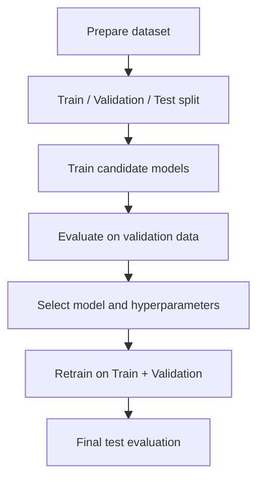

Throughout this chapter, we have examined several classical machine learning algorithms for building recommender systems.

We learned that **Linear Regression** can be used when the objective is to predict a continuous numerical variable, such as the rating a user might assign to an item. When the objective is to predict a categorical outcome, **Logistic Regression** can estimate the probability that an observation belongs to a particular class, such as whether a user will click on or purchase a product.

We subsequently explored **Feature Engineering** and learned how transforming existing features and constructing new ones can help models capture relationships that are not adequately represented by simple linear functions.

Finally, we examined **Decision Trees** and tree-based ensemble methods, including Random Forest and Gradient Boosting, and investigated their ability to model complex nonlinear relationships in both regression and classification tasks.

Having studied these algorithms, an important question arises:

**Which model should we choose for a particular recommendation problem?**

There is no universally optimal model. The appropriate choice depends on the characteristics of the dataset, the prediction task, the available computational resources, and the objectives of the recommendation system.

The answer lies in systematic **Evaluation** and **Comparison**.

Rigorous evaluation is an essential stage in developing any recommender system. It enables us to compare candidate models, select appropriate hyperparameters, assess generalization performance, and identify weaknesses that can guide further improvements.

## 1. Why Evaluate and Compare Models?

Model evaluation serves several important purposes.

### 1.1. Quantifying Predictive Performance

When different models have comparable computational requirements, quantitative evaluation provides an objective basis for selecting among them.

For example, suppose we train two models for a rating prediction task:

- A Linear Regression model.
- A Decision Tree Regression model.

Assume that both models have similar memory requirements and sufficiently low prediction latency.

In this situation, comparing their predictive errors on the same evaluation dataset allows us to determine which model produces more accurate rating predictions.

Without quantitative evaluation, choosing between these models would rely primarily on assumptions rather than empirical evidence.

### 1.2. Model Selection and Hyperparameter Optimization

Evaluation is also essential when comparing different algorithms or different configurations of the same algorithm.

Consider a Random Forest trained on a large recommendation dataset.

Several questions arise:

- How many trees should the forest contain?
- What should the maximum depth of each tree be?
- How much additional accuracy is obtained by increasing model complexity?
- Does the improvement justify the additional computational cost?

A larger model does not necessarily produce better predictions.

By evaluating different configurations, we can identify an appropriate balance between predictive performance and model complexity.

### 1.3. Assessing Generalization

The primary objective of supervised machine learning is not simply to reproduce the training observations.

Instead, a model should learn patterns that remain useful when making predictions for previously unseen observations.

This ability is called **Generalization**.

A model may achieve excellent performance on its training dataset while performing poorly on new data.

Such behavior is characteristic of **Overfitting**.

Evaluating a model on observations that were not used during training helps us estimate how well the learned relationships generalize beyond the training sample.

However, evaluation on unseen data provides evidence of generalization rather than an absolute guarantee. Its reliability depends on whether the evaluation dataset adequately represents the conditions under which the model will be deployed.

### 1.4. Identifying Model Weaknesses

Aggregate performance metrics can conceal important differences in how a model behaves across user and item groups.

For example, a recommendation model may perform well for users with extensive interaction histories but poorly for users with very few interactions.

Similarly, a model may generate accurate predictions for popular items while struggling with newly introduced products.

Evaluating these groups separately helps identify limitations such as:

- Cold-start problems.
- Data sparsity.
- Uneven performance across user groups.
- Poor predictions for unpopular or rarely observed items.

These findings can guide feature engineering, model selection, and the design of hybrid recommendation strategies.

## 2. Designing a Fair Evaluation Procedure

To evaluate models fairly, particularly when selecting algorithms and tuning hyperparameters, the available data should generally be divided into three distinct subsets:

1. Training Set.
2. Validation Set.
3. Test Set.

Each subset serves a different purpose.

### 2.1. Training Set

The **Training Set** is the portion of the dataset used to estimate model parameters.

It typically contains the largest proportion of the available observations, often approximately 60–80%, depending on the dataset size and evaluation design.

In a recommender system, training observations may consist of user–item pairs together with their associated features and observed outcomes.

For example, a training observation may contain:

- User age.
- Item category.
- Historical purchase frequency.
- Time spent viewing the item.
- Whether the user purchased the item.

During training, the algorithm learns relationships between the input features and the target variable.

For Linear Regression, this involves estimating regression coefficients.

For Decision Trees, it involves selecting splitting features and thresholds.

For Random Forests, it involves constructing multiple decision trees from the training observations.

### 2.2. Validation Set

The **Validation Set** is used for model selection and hyperparameter tuning.

It may contain approximately 10–20% of the available observations.

The model is not directly fitted to the validation observations during an ordinary training run.

Instead, the validation set is used to evaluate alternative configurations.

For example, suppose we want to select the maximum depth of a Decision Tree.

We might train several models with different values of `max_depth`.

Each model is trained using the training set and evaluated using the validation set.

The configuration that achieves the best validation performance is selected.

The same procedure can be used to compare different algorithms, such as Logistic Regression, Random Forest, and Gradient Boosting.

### 2.3. Test Set

The **Test Set** is reserved for the final evaluation of the selected model.

It may also contain approximately 10–20% of the available observations.

Unlike the validation set, the test set must not influence the selection of algorithms, features, or hyperparameters.

After choosing the model and its hyperparameters, we evaluate its performance on the test set.

This provides an estimate of how the selected model is likely to perform on previously unseen data, provided that the test set is representative and has not been used during model development.

The test set should ideally be used only once for final evaluation.

### 2.4. Example of a Three-Way Split

Consider a dataset containing 100,000 user–item interactions.

One possible partition is:

<box border radius="lg" padding={3} gap={3}>
  <box direction="row" height="42px" radius="md" clip>
    <box background="#2563eb" flex={70} align="center" justify="center">
      <text color="#ffffff" weight="medium" size="sm">Train 70%</text>
    </box>
    <box background="#0d9488" flex={15} align="center" justify="center">
      <text color="#ffffff" weight="medium" size="xs">15%</text>
    </box>
    <box background="#d97706" flex={15} align="center" justify="center">
      <text color="#ffffff" weight="medium" size="xs">15%</text>
    </box>
  </box>
  <grid columns={3} gap={2}>
    <grid-item>
      <text weight="medium" size="sm">Training</text>
      <text color="secondary" size="xs">70,000 interactions</text>
    </grid-item>
    <grid-item>
      <text weight="medium" size="sm">Validation</text>
      <text color="secondary" size="xs">15,000 interactions</text>
    </grid-item>
    <grid-item>
      <text weight="medium" size="sm">Testing</text>
      <text color="secondary" size="xs">15,000 interactions</text>
    </grid-item>
  </grid>
  <caption>Figure: An illustrative 70/15/15 partition of a recommendation dataset.</caption>
</box>

The percentages are not fixed rules. They should be selected according to the dataset size, evaluation objectives, and the need for sufficiently representative subsets.

## 3. Why Are Three Separate Datasets Necessary?

An important question is why a validation set is necessary when we already have training and test sets.

The answer concerns **overfitting during model selection**.

### 3.1. Overfitting to the Training Set

During training, the model adjusts its parameters to minimize an objective function.

If the model is excessively complex, it may learn patterns that are specific to the training observations.

This can produce low training error but high error on unseen data.

Validation and test observations help reveal this behavior.

### 3.2. Overfitting to the Validation Set

Although model parameters are not ordinarily learned directly from validation observations, the validation set still influences model development.

Suppose we train hundreds of models using different algorithms, feature combinations, and hyperparameters.

We evaluate every configuration on the same validation set and select the one with the highest validation performance.

Through this repeated selection process, we may eventually choose a model that performs unusually well on the particular validation observations.

Some of that apparent advantage may reflect random characteristics of the validation set rather than genuinely superior generalization.

This phenomenon is known as **overfitting to the validation set**.

Consequently, validation performance alone is not sufficient to provide an unbiased estimate of final model performance.

### 3.3. The Role of the Independent Test Set

The test set addresses this problem by remaining independent of both training and model selection.

The complete evaluation procedure is:

1. Train candidate models using the training set.
2. Evaluate alternative models and hyperparameters using the validation set.
3. Select the preferred configuration.
4. Optionally retrain the selected configuration using the combined training and validation data.
5. Evaluate the final model once using the test set.

The resulting test performance provides a more reliable estimate of generalization.

If the test results are repeatedly used to revise the model, the test set effectively becomes another validation set, weakening its value as an independent evaluation resource.

### 3.4. Splitting Interaction Data in Recommender Systems

Recommendation datasets require particular attention because observations are not necessarily independent.

Multiple interactions may belong to the same user, and the same item may appear in many observations.

As discussed in the feature engineering exercises, a common strategy is to randomly divide interaction records so that interactions from individual users may appear across the training, validation, and test sets.

This strategy is useful when evaluating predictions for users and items that are already represented in the training data.

However, it is not appropriate for every recommendation scenario.

For example:

- **Temporal evaluation:** Training uses earlier interactions, while validation and testing use later interactions.
- **New-user evaluation:** Users in the test set are absent from the training set.
- **New-item evaluation:** Test items are excluded from training interactions.

The splitting strategy must therefore match the intended recommendation task.

### 3.5. Preventing Data Leakage

**Data Leakage** occurs when information unavailable at prediction time influences model training or feature construction.

For example, calculating a user's average rating using interactions from the test set would expose information that the model should not have access to.

To prevent leakage, preprocessing and feature engineering operations that learn statistics from data should be fitted using only the training observations.

The learned transformations should then be applied consistently to validation and test data.

Examples include:

- Feature scaling.
- Missing-value imputation.
- Categorical encoding.
- Feature selection.
- Aggregated interaction statistics.

After final model selection, some workflows refit preprocessing transformations using the combined training and validation data before the final test evaluation.

However, the test set must remain excluded from these operations.

## 4. Selecting Appropriate Evaluation Metrics

Different prediction tasks require different evaluation metrics.

In particular, regression, classification, and ranking measure different aspects of model performance.

A metric suitable for predicting numerical ratings may not be appropriate for evaluating purchase probabilities or ranked recommendation lists.

### 4.1. Regression Metrics

Regression metrics evaluate the difference between predicted numerical values and their observed targets.

Common metrics include RMSE, MAE, and R-Squared.

#### Root Mean Squared Error (RMSE)

RMSE measures the square root of the average squared prediction error.

$$
RMSE=\sqrt{\frac{1}{N}\sum_{i=1}^{N}(y_{i}-\hat{y}_{i})^{2}}
$$

Where:

- $N$ is the number of evaluated observations.
- $y_{i}$ is the observed target value.
- $\hat{y}_{i}$ is the predicted target value.

Because prediction errors are squared, RMSE assigns greater weight to larger errors.

This makes it useful when large prediction mistakes are particularly undesirable.

For example, predicting a rating of 1 for an item that a user actually rates 5 contributes substantially more to RMSE than predicting 4 for an item rated 5.

**Lower RMSE values indicate better performance.**

#### Mean Absolute Error (MAE)

MAE measures the average absolute difference between predicted and observed values.

$$
MAE=\frac{1}{N}\sum_{i=1}^{N}\lvert y_{i}-\hat{y}_{i}\rvert
$$

Unlike RMSE, MAE does not square prediction errors.

Consequently, it is less sensitive to unusually large errors.

MAE is also straightforward to interpret because it expresses the average absolute prediction error in the same units as the target variable.

**Lower MAE values indicate better performance.**

#### R-Squared

The **Coefficient of Determination**, commonly denoted by $R^{2}$, measures model performance relative to a baseline that predicts the mean observed target value.

It is defined as:

$$
R^{2}=1-\frac{\sum_{i=1}^{N}(y_{i}-\hat{y}_{i})^{2}}{\sum_{i=1}^{N}(y_{i}-\bar{y})^{2}}
$$

Where:

- $\bar{y}$ is the mean observed target value.
- $y_{i}$ is the observed target.
- $\hat{y}_{i}$ is the predicted target.

An $R^{2}$ value of 1 indicates perfect predictions.

A value of 0 indicates performance equivalent to predicting the mean target value.

Negative values are also possible when a model performs worse than this baseline.

Although $R^{2}$ is often described as the proportion of variance explained by a regression model, this interpretation requires care, particularly when evaluating predictions on unseen data.

**Higher $R^{2}$ values generally indicate better performance.**

### 4.2. Classification Metrics

Classification metrics evaluate predictions involving discrete class labels.

In recommender systems, classification tasks may include predicting whether a user will:

- Click an item.
- Purchase a product.
- Like a movie.
- Subscribe to a service.
- Interact with a recommendation.

Common metrics include Accuracy, Precision, Recall, F1-Score, and AUC.

#### Accuracy

Accuracy measures the proportion of correctly classified observations.

$$
Accuracy=\frac{TP+TN}{TP+TN+FP+FN}
$$

Where:

- $TP$: True Positives.
- $TN$: True Negatives.
- $FP$: False Positives.
- $FN$: False Negatives.

Accuracy is intuitive but can be misleading when the class distribution is highly imbalanced.

For example, if only 2% of users purchase a recommended product, a model that always predicts no purchase achieves 98% accuracy while failing to identify any actual purchases.

#### Precision

Precision measures the proportion of predicted positive observations that are actually positive.

$$
Precision=\frac{TP}{TP+FP}
$$

Precision is particularly important when false-positive predictions are costly.

For example, a recommendation system may prioritize high Precision when displaying irrelevant recommendations would significantly reduce user satisfaction.

#### Recall

Recall, also called Sensitivity or True Positive Rate, measures the proportion of actual positive observations correctly identified by the model.

$$
Recall=\frac{TP}{TP+FN}
$$

Recall is especially important when false negatives are costly.

For example, a recommendation system designed to discover relevant items may prioritize Recall to avoid overlooking products that users would find valuable.

#### F1-Score

F1-Score combines Precision and Recall using their harmonic mean.

$$
F1=\frac{2\cdot Precision\cdot Recall}{Precision+Recall}
$$

F1-Score is useful when both false positives and false negatives matter.

A high F1-Score requires a reasonable balance between Precision and Recall.

However, it does not account for true negatives and may not be the most appropriate metric for every classification problem.

#### Area Under the ROC Curve (AUC)

**AUC**, commonly referring to the Area Under the Receiver Operating Characteristic Curve (ROC-AUC), measures how effectively a model distinguishes positive observations from negative observations across different classification thresholds.

The ROC curve plots:

- True Positive Rate (TPR) on the vertical axis.
- False Positive Rate (FPR) on the horizontal axis.

The False Positive Rate is defined as:

$$
FPR=\frac{FP}{FP+TN}
$$

The True Positive Rate is equivalent to Recall:

$$
TPR=\frac{TP}{TP+FN}
$$

<box maxWidth="480px" width="100%" padding={2}>
  <svg
    viewBox="0 0 480 340"
    width="100%"
    preserveAspectRatio="xMidYMid meet"
    xmlns="http://www.w3.org/2000/svg"
  >
    {/* Background */}
    <rect x="0" y="0" width="480" height="340" fill="none" />

    {/* AUC: area under ROC curve */}
    <path
      d="M76 260 C88 160 130 105 195 77 C265 48 350 45 430 45 L430 260 Z"
      fill="#3B82F6"
      fillOpacity="0.10"
      stroke="none"
    />

    {/* Coordinate axes */}
    <path
      d="M76 45 V260 H430"
      fill="none"
      stroke="currentColor"
      strokeWidth="1.5"
      opacity="0.75"
    />

    {/* Random-classifier baseline */}
    <path
      d="M76 260 L430 45"
      fill="none"
      stroke="#94A3B8"
      strokeWidth="1.8"
      strokeDasharray="6 5"
    />

    {/* ROC curve */}
    <path
      d="M76 260 C88 160 130 105 195 77 C265 48 350 45 430 45"
      fill="none"
      stroke="#2563EB"
      strokeWidth="3.5"
      strokeLinecap="round"
    />

    {/* Axis tick labels */}
    <g fill="currentColor" fontSize="12">
      <text x="76" y="280" textAnchor="middle">0</text>
      <text x="430" y="280" textAnchor="middle">1</text>
      <text x="64" y="49" textAnchor="end">1</text>
    </g>

    {/* Axis titles */}
    <g fill="currentColor" fontSize="13">
      <text x="253" y="313" textAnchor="middle">
        False Positive Rate
      </text>
      <text
        x="20"
        y="154"
        textAnchor="middle"
        transform="rotate(-90 20 154)"
      >
        True Positive Rate
      </text>
    </g>

    {/* AUC label */}
    <text
      x="235"
      y="115"
      fill="#60A5FA"
      fontSize="18"
      fontWeight="600"
      textAnchor="middle"
    >
      AUC
    </text>

    {/* ROC curve label */}
    <text
      x="260"
      y="35"
      fill="#3B82F6"
      fontSize="13"
      fontWeight="600"
      textAnchor="middle"
    >
      ROC Curve
    </text>

    {/* Random classifier label: positioned near diagonal */}
    <text
      x="305"
      y="203"
      fill="#94A3B8"
      fontSize="12"
      textAnchor="middle"
    >
      Random Classifier
    </text>
  </svg>
</box>
ROC-AUC ranges from 0 to 1.

Important reference values include:

- **AUC = 1:** Perfect discrimination.
- **AUC = 0.5:** Discrimination equivalent to random ranking.
- **AUC below 0.5:** The model tends to rank negative observations above positive observations.

AUC is widely used for evaluating interaction prediction models in recommender systems.

It is independent of a single classification threshold and can be informative when classes are imbalanced.

However, ROC-AUC is not universally insensitive to class imbalance. In problems involving extremely rare positive outcomes, Precision–Recall curves and their associated metrics may provide a more informative evaluation.

### 4.3. Ranking Metrics

The final output of many recommender systems is an ordered list of items rather than a single numerical prediction or class label.

Ranking metrics directly evaluate the quality of these ordered recommendations.

#### Precision@K

Precision@K measures the proportion of relevant items among the top $K$ recommended items.

$$
Precision@K=\frac{\lvert Rel_{u}\cap Rec_{u}^{K}\rvert}{K}
$$

Where:

- $Rel_{u}$ is the set of relevant items for user $u$.
- $Rec_{u}^{K}$ is the set of the top $K$ items recommended to user $u$.

For example, if six of the top ten recommendations are relevant:

$$
Precision@10=\frac{6}{10}=0.6
$$

#### Recall@K

Recall@K measures the proportion of all relevant items that appear among the top $K$ recommendations.

$$
Recall@K=\frac{\lvert Rel_{u}\cap Rec_{u}^{K}\rvert}{\lvert Rel_{u}\rvert}
$$

Suppose a user has 20 relevant items and six appear among the top ten recommendations.

Then:

$$
Recall@10=\frac{6}{20}=0.3
$$

#### Normalized Discounted Cumulative Gain (NDCG)

**NDCG** evaluates both the relevance of recommended items and their positions in the ranked list.

It assigns greater importance to relevant items appearing near the beginning of the list.

Discounted Cumulative Gain at position $K$ is commonly defined as:

$$
DCG@K=\sum_{i=1}^{K}\frac{2^{rel_{i}}-1}{\log_{2}(i+1)}
$$

Where $rel_{i}$ is the relevance score of the item at position $i$.

NDCG normalizes this value by the maximum possible DCG for the same set of relevance labels:

$$
NDCG@K=\frac{DCG@K}{IDCG@K}
$$

Where $IDCG@K$ is the ideal DCG at position $K$.

NDCG generally ranges from 0 to 1 when relevance scores are nonnegative and the ideal DCG is positive.

Higher values indicate better ranking quality.

Ranking metrics are particularly important when evaluating complete recommendation systems, which may combine several models and algorithms into a single recommendation pipeline.

## 5. Comparing Models

After training candidate models and selecting their hyperparameters using validation data, we can compare their predictive performance.

For a fair comparison, models addressing the same prediction task should be evaluated using the same held-out observations and the same evaluation protocol.

Consider a recommender system in which we have trained several regression and classification models.

The following table presents hypothetical evaluation results.

| Model | RMSE ↓ | MAE ↓ | R-Squared ↑ | Accuracy ↑ | Precision ↑ | Recall ↑ | F1-Score ↑ | AUC ↑ |
|---|---:|---:|---:|---:|---:|---:|---:|---:|
| Linear Regression | 1.25 | 0.98 | 0.72 | N/A | N/A | N/A | N/A | N/A |
| Logistic Regression | N/A | N/A | N/A | 0.78 | 0.70 | 0.65 | 0.67 | 0.85 |
| Random Forest (Regression) | 1.05 | 0.75 | 0.81 | N/A | N/A | N/A | N/A | N/A |
| LightGBM (Classification) | N/A | N/A | N/A | 0.82 | 0.78 | 0.72 | 0.75 | 0.91 |

The arrows indicate the preferred direction of each metric:

- Downward arrows indicate that lower values are better.
- Upward arrows indicate that higher values are better.

### 5.1. Comparing Regression Models

For the rating prediction task, Random Forest Regression outperforms Linear Regression on all three reported metrics.

Its RMSE decreases from 1.25 to 1.05.

Its MAE decreases from 0.98 to 0.75.

Its $R^{2}$ increases from 0.72 to 0.81.

These results suggest that the Random Forest captures relationships that the linear model does not represent as effectively.

One possible explanation is the presence of nonlinear relationships or interactions among user and item features.

However, the table alone does not establish the precise cause of the performance difference.

### 5.2. Comparing Classification Models

For the interaction prediction task, LightGBM outperforms Logistic Regression on all reported classification metrics.

Its Accuracy increases from 0.78 to 0.82.

Its Precision increases from 0.70 to 0.78.

Its Recall increases from 0.65 to 0.72.

Its F1-Score increases from 0.67 to 0.75.

Its AUC increases from 0.85 to 0.91.

These results indicate that LightGBM provides better discrimination and classification performance under the evaluation conditions represented by the table.

Nevertheless, predictive performance is only one consideration when selecting a production model.

Computational requirements, inference latency, interpretability, and operational complexity may also influence the final decision.

## 6. Additional Considerations in Model Evaluation

A single evaluation metric cannot provide a complete description of model performance.

A model may achieve a high overall score while exhibiting serious weaknesses in particular scenarios.

A comprehensive evaluation should therefore consider multiple dimensions of model behavior.

### 6.1. Monitoring Performance During Training

For iterative learning algorithms, it is useful to monitor training and validation performance throughout the optimization process.

Examples include:

- Gradient Boosting.
- Neural networks trained using gradient-based optimization.
- Other models trained through iterative parameter updates.

Performance may be recorded after each epoch or boosting iteration.

A common pattern associated with overfitting occurs when training error continues to decrease while validation error begins to increase.

<Chart content={{"chartType":"line","meta":{"title":"Illustrative training and validation loss","description":"Validation loss begins increasing after iteration 6, while training loss continues decreasing."},"xKey":"iteration","series":[{"dataKey":"train","label":"Training loss"},{"dataKey":"validation","label":"Validation loss"}],"yAxisMin":0,"data":[{"iteration":1,"train":0.91,"validation":0.97},{"iteration":2,"train":0.72,"validation":0.78},{"iteration":3,"train":0.59,"validation":0.66},{"iteration":4,"train":0.48,"validation":0.57},{"iteration":5,"train":0.39,"validation":0.52},{"iteration":6,"train":0.32,"validation":0.50},{"iteration":7,"train":0.27,"validation":0.53},{"iteration":8,"train":0.23,"validation":0.58},{"iteration":9,"train":0.19,"validation":0.64},{"iteration":10,"train":0.16,"validation":0.72}]}}/>

This behavior suggests that the model is becoming increasingly specialized to the training observations.

A common solution is **Early Stopping**.

Early Stopping terminates training when validation performance stops improving sufficiently.

For example, a Gradient Boosting model may stop adding trees after a specified number of iterations without improvement in validation loss.

This can reduce overfitting and unnecessary computation.

### 6.2. Evaluating Performance Across Data Subgroups

Overall performance should be supplemented with evaluations of important user and item subgroups.

Examples include:

- New users versus existing users.
- New items versus popular items.
- Users with few interactions versus users with many interactions.

These comparisons are especially important in recommender systems because interaction data is frequently sparse and unevenly distributed.

For example, a collaborative filtering model may perform well for active users but poorly for users with limited interaction histories.

A content-based model may exhibit the opposite pattern when sufficient item metadata is available.

Subgroup evaluation can reveal these differences and help determine whether multiple models should be used for different recommendation scenarios.

This may motivate a hybrid architecture in which the system selects an appropriate recommendation strategy based on the available user and item information.

### 6.3. Error Analysis

Error analysis involves examining observations for which the model produces incorrect or inaccurate predictions.

For regression tasks, we may inspect observations with the largest absolute or squared errors.

For classification tasks, we may examine:

- False positives.
- False negatives.

The objective is to identify patterns associated with prediction failures.

For example:

- Are errors concentrated among new users?
- Does the model perform poorly for particular product categories?
- Are high-priced products more difficult to predict?
- Do certain demographic or behavioral features appear frequently among misclassified observations?

Such patterns may reveal limitations in the training data, feature representation, or model architecture.

The findings can guide subsequent feature engineering and model improvements.

### 6.4. Practical and Operational Considerations

Predictive accuracy is not the only criterion for choosing a recommendation model.

Several practical considerations may be equally important.

#### Computational Speed

Both training time and prediction latency matter.

Training time determines how frequently the model can be updated.

Prediction latency determines how quickly the system can respond to a recommendation request.

In applications requiring real-time recommendations, the model may need to generate predictions for many candidate items within a strict response-time budget.

A highly accurate model may be unsuitable if its inference latency is too high.

#### Scalability

Scalability describes the ability of a model and its supporting infrastructure to handle increasing data volumes and workloads.

Relevant questions include:

- Can the model be trained on millions of user–item interactions?
- How does memory consumption grow with the dataset?
- Does training require specialized hardware?
- Can predictions be generated efficiently for large candidate sets?

A model that performs well on a small experimental dataset may become impractical at production scale.

#### Interpretability

Interpretability concerns the extent to which we can understand why a model produces a particular prediction.

Linear models provide coefficients that describe the contributions of features under the model's assumptions.

Small decision trees provide explicit decision paths.

Tree-based ensembles can provide feature importance estimates and may be analyzed using model explanation techniques.

However, feature importance does not necessarily establish causal influence, and interpreting complex ensembles generally requires more sophisticated methods.

## 7. Improving Model Performance

Evaluation should guide the model development process.

Once weaknesses have been identified, the next step is to determine which modifications are most likely to improve performance.

The appropriate strategy depends on the type of problem observed.

### 7.1. Addressing Underfitting

**Underfitting** occurs when a model is too simple to capture the underlying relationships in the data.

It is often associated with poor performance on both training and evaluation datasets.

Possible improvements include:

1. **Increasing model complexity.** For example, replacing a simple linear model with a tree-based model capable of learning nonlinear relationships.
2. **Engineering more informative features.** Additional behavioral, contextual, or interaction features may reveal patterns not represented by the existing inputs.
3. **Adjusting hyperparameters.** Increasing tree depth, reducing regularization strength, or allowing additional boosting iterations may improve the model's ability to fit the data.

The objective is to increase the model's capacity to represent meaningful patterns without introducing excessive complexity.

### 7.2. Addressing Overfitting

**Overfitting** occurs when a model fits the training data well but performs poorly on unseen observations.

Possible improvements include:

1. **Increasing regularization strength.** Stronger regularization can discourage unnecessarily complex models.
2. **Reducing model complexity.** Shallower trees or simpler model architectures may generalize more effectively.
3. **Collecting additional training data.** More representative observations can reduce the model's dependence on accidental patterns in a small dataset.
4. **Applying Early Stopping.** Training can be terminated when validation performance stops improving.
5. **Adjusting hyperparameters.** Reducing maximum tree depth, increasing minimum leaf size, or limiting the number of boosting iterations can help control overfitting.

These interventions should be evaluated using validation data rather than the final test set.

### 7.3. Addressing Weak Performance in Specific Scenarios

Some models perform well overall but struggle in particular recommendation scenarios.

Cold start is a common example.

A collaborative filtering model may perform poorly for users or items with few historical interactions.

Possible improvements include:

- Engineering additional side-information features.
- Incorporating user demographics or item metadata when appropriate.
- Using content-based models for new items.
- Investigating hybrid recommendation strategies.

A hybrid system may combine collaborative filtering with content-based or machine learning models to improve robustness across different user and item groups.

## 8. Hyperparameter Tuning

**Hyperparameter Tuning** is the process of identifying suitable hyperparameter values for a machine learning algorithm.

Hyperparameters control aspects of the learning procedure or model architecture.

Examples include:

- Number of trees in a Random Forest.
- Maximum depth of a Decision Tree.
- Learning rate in Gradient Boosting.
- Regularization strength in Linear or Logistic Regression.

Unlike model parameters, hyperparameters are generally specified before training.

The objective of hyperparameter tuning is to identify the configuration that performs best according to a selected validation metric.

### 8.1. General Hyperparameter Tuning Procedure

The procedure typically involves the following steps:

1. Define a set of candidate hyperparameter configurations.
2. Train a model for each configuration using the training data.
3. Evaluate each trained model using validation data.
4. Compare the evaluation results.
5. Select the configuration with the best validation performance.

For example, when tuning a Random Forest, we may experiment with different combinations of:

- `n_estimators`
- `max_depth`
- `min_samples_split`
- `min_samples_leaf`

The selected configuration should balance predictive performance with computational and operational requirements.

### 8.2. Grid Search and Randomized Search

Scikit-learn provides tools that automate hyperparameter optimization.

Two widely used methods are:

**GridSearchCV**

Grid Search evaluates every combination of hyperparameter values specified in a search grid.

It is useful when the search space is relatively small and exhaustive evaluation is computationally feasible.

**RandomizedSearchCV**

Randomized Search samples a specified number of hyperparameter configurations from predefined distributions or candidate sets.

It is often more computationally efficient than exhaustive Grid Search when the search space is large.

Both tools use cross-validation to evaluate candidate configurations.

During cross-validation, the available training data is divided into multiple folds.

The model is repeatedly trained on a subset of folds and evaluated on the remaining fold or folds.

The results are aggregated to estimate validation performance.

For recommendation datasets, cross-validation should be designed carefully to avoid leakage between related interactions or across time.

## 9. Efficient Model Selection for Large Datasets

In some recommendation applications, the available dataset may be too large to train and evaluate many models using the complete training data.

Computational limitations may include:

- Insufficient memory.
- Long training times.
- Limited processing capacity.
- High infrastructure costs.

In such situations, **sampling** can make initial experimentation more efficient.

### 9.1. Model Selection Using a Representative Sample

Instead of immediately training every candidate model on the complete dataset, we can select a smaller representative subset.

This subset can be used to:

1. Compare candidate learning algorithms.
2. Identify promising feature representations.
3. Explore hyperparameter configurations.
4. Eliminate models that perform poorly or require excessive computation.

The sample should preserve important characteristics of the original dataset.

For recommender systems, these may include:

- User activity distributions.
- Item popularity distributions.
- Interaction sparsity.
- Rating distributions.
- Relevant temporal patterns.

A poorly constructed sample may lead to model-selection decisions that do not generalize to the complete dataset.

### 9.2. Training the Final Model

After selecting the preferred algorithm and hyperparameters using validation data or cross-validation, the final model can be trained using all available development data.

This generally includes:

- The original training set.
- The validation set.

Combining these subsets allows the final model to learn from more observations.

The test set remains excluded from training and preprocessing operations.

The final evaluation is then performed once on the independent test set.

The complete workflow can be summarized as follows:

*Figure: Model selection and final evaluation workflow. The test set is reserved until the final model has been selected and trained.*

This approach allows computationally expensive model selection to be performed efficiently while preserving an independent evaluation of the final model's generalization performance.