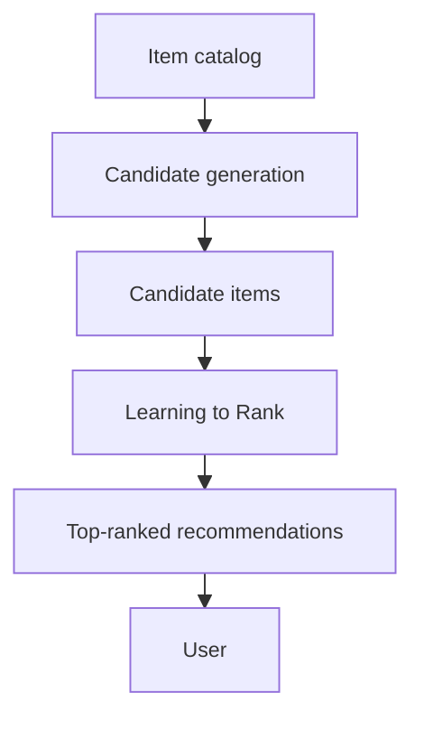

Every time a user visits a movie-streaming service such as Netflix or an online marketplace such as Amazon, they encounter an ordered list of movies, products, or other items selected specifically for them.

An important question is often overlooked: **How is the order of these items determined?**

Why does one movie appear at the beginning of the recommendation list while another appears near the bottom? What determines which products receive the most prominent positions?

Answering these questions is the central objective of **Learning to Rank (LTR)**, an important area of machine learning used extensively in modern information retrieval and recommender systems.

The transition from predicting individual relevance scores to optimizing the ordering of recommendations is a fundamental step toward developing effective, large-scale recommender systems.

## 1. What Is Learning to Rank?

**Learning to Rank (LTR)** is a machine learning task concerned with learning how to order a collection of items according to their relevance or priority with respect to a particular user, query, or context.

The objective is to construct a model that can rank a set of candidate items, such as documents, products, movies, or other entities, so that the most relevant items appear in the most prominent positions.

For example, a movie recommendation system may identify several potentially interesting movies for a user. An LTR model determines their relative ordering based on the user's preferences and the available information about each movie.

The fundamental objective is to produce a ranking that best satisfies the user's information needs or preferences.

### 1.1. Learning to Rank as a Machine Learning Task

To understand the position of LTR within machine learning, consider three common learning tasks.

**Classification**

Classification involves assigning an observation to one of several predefined categories.

For example:

> Is this email spam or not spam?

The output is a categorical label.

**Regression**

Regression involves predicting a continuous numerical value.

For example:

> What is the estimated price of this house?

The output is a numerical prediction.

**Ranking**

Ranking involves determining the relative ordering of multiple observations.

For example:

> Which of these movies should appear first in a particular user's recommendation list?

Unlike conventional regression and classification, the primary objective is not necessarily to predict the exact numerical value or category of each item.

Instead, the objective is to determine which items should appear ahead of others.

For instance, an LTR model does not necessarily need to predict that a user would assign a movie a rating of exactly 4.7. It may be sufficient to learn that this movie should rank above another movie for that user.

This distinction is essential because a model can produce relatively accurate numerical predictions while still generating an undesirable ordering.

### 1.2. LTR Is a Task, Not a Single Algorithm

An important distinction is that **Learning to Rank is not the name of a particular machine learning algorithm**.

Rather, it describes a category of machine learning problems.

Just as classification refers to predicting categorical labels and regression refers to predicting continuous values, ranking refers to learning an ordering over a collection of observations.

Different algorithms can be adapted to solve ranking problems.

For example, ranking models may be constructed using:

- Regression algorithms that estimate relevance scores.
- Classification algorithms that estimate relevance categories or probabilities.
- Pairwise preference models that compare two items.
- Listwise models that optimize properties of an entire ranked list.

Consequently, LTR encompasses several learning approaches rather than a single model architecture.

### 1.3. Applications of Learning to Rank

LTR is useful wherever a system must present an ordered collection of results.

#### Web Search

Search engines are among the most established applications of LTR.

When a user submits a search query, the search engine identifies potentially relevant web pages and ranks them according to their estimated usefulness.

The objective is to place the most relevant results near the top of the search results page.

Ranking models may consider numerous signals, including textual relevance, document characteristics, user context, and historical interaction patterns.

#### Question-Answering Platforms

On platforms such as Stack Overflow and Quora, a single question may receive multiple answers.

A ranking model can help order these answers according to factors such as:

- Relevance to the question.
- Completeness.
- Helpfulness.
- Community feedback.
- Historical engagement.

The objective is to present the most useful answers first.

#### Recommender Systems

LTR is also widely used in recommender systems.

For example, an online marketplace may need to rank products that a user is likely to purchase after buying another item.

The ranking model can consider the user's profile, purchasing history, item characteristics, and current context to determine the order in which products should be displayed.

By placing more relevant items near the beginning of the list, LTR can improve user engagement, conversion rates, and satisfaction.

These improvements may also contribute to better user retention and loyalty.

However, such benefits depend on the quality of the ranking model and must be established through appropriate evaluation.

## 2. Training Data for Learning to Rank

LTR models require training data that describes the relevance of candidate items to particular queries or users.

Although individual datasets may differ, many supervised ranking datasets follow a common structure.

A ranking observation can be represented conceptually by the following four components:

**(Query, Item, Features, Relevance Label)**

Each component plays a specific role.

### 2.1. Query

The **Query** identifies the information need or recommendation context for which items must be ranked.

In information retrieval, the query may be a search phrase entered by a user.

In recommender systems, the query may correspond to:

- A user identifier.
- A user session.
- A particular recommendation request.
- A user together with contextual information.

The query determines which candidate items are being compared.

For example, the same movie may be highly relevant to one user but less relevant to another.

Therefore, relevance is evaluated relative to the query or recommendation context.

### 2.2. Item

The **Item** is an entity that must be ranked.

Depending on the application, items may include:

- Web pages.
- Products.
- Movies.
- Songs.
- Articles.
- Answers to questions.

For each query, the system typically considers a collection of candidate items and attempts to determine their most appropriate ordering.

### 2.3. Features

**Features** describe characteristics of the query, item, or relationship between them.

In a recommender system, features may include:

- User age.
- User purchase history.
- Item category.
- Item popularity.
- Historical click-through rate.
- Predicted rating from a collaborative filtering model.
- Similarity between user and item embeddings.
- Time of day.
- Device type.

The ranking model learns how these features relate to item relevance and ranking preferences.

### 2.4. Relevance Labels

The **Relevance Label** indicates how relevant an item is to a particular query or user.

Relevance labels provide the supervision needed to train a ranking model.

These labels may be derived from explicit or implicit feedback.

#### Explicit Feedback

Explicit feedback consists of information directly provided by users or human evaluators.

For example, a search quality evaluator might assign a relevance grade from 1 to 5 to a search result.

Similarly, a user may provide a numerical rating for a movie.

These values can serve as relevance labels when training ranking models.

#### Implicit Feedback

Implicit feedback is inferred from observed user behavior.

Examples include:

- Clicking a search result.
- Adding a product to a shopping cart.
- Purchasing a product.
- Watching a video to completion.
- Liking a social media post.

These interactions can provide signals about item relevance.

However, implicit feedback does not always correspond directly to user satisfaction.

For example, a user may click an item because its title is attractive but subsequently discover that the content is irrelevant.

Similarly, an item displayed near the top of a list may receive more clicks simply because it is more visible.

Therefore, implicit feedback often requires careful processing to account for noise and exposure bias.

### 2.5. Example: Search Engine Ranking Data

Consider the following simplified ranking dataset.

| Query ID | Item | Feature 1 | Feature 2 | Relevance |
|---|---|---:|---:|---:|
| Q1 | Page A | 0.85 | 0.70 | 3 |
| Q1 | Page B | 0.60 | 0.90 | 2 |
| Q1 | Page C | 0.30 | 0.40 | 0 |
| Q2 | Page D | 0.95 | 0.80 | 3 |
| Q2 | Page E | 0.45 | 0.60 | 1 |

Here:

- `Query ID` identifies the search request.
- `Item` identifies a candidate web page.
- `Feature 1` and `Feature 2` represent numerical characteristics of the query–document pair.
- `Relevance` is the target relevance grade.

For query `Q1`, the ideal ranking is:

1. Page A.
2. Page B.
3. Page C.

The model should learn how to produce this ordering from the available features.

Importantly, relevance comparisons are generally meaningful within the same query group. Items belonging to unrelated queries are not necessarily directly comparable.

### 2.6. Example: Product Ranking on Amazon

Suppose an online marketplace wants to rank products that a user might purchase after buying a particular item.

The system can construct a dataset containing:

- The current user or purchasing context.
- Candidate products.
- Features describing the user and products.
- Historical interaction signals indicating product relevance.

For example, the features might include the similarity between the previously purchased product and each candidate, the user's historical preferences, product popularity, and price.

The ranking model learns how these features relate to subsequent purchases.

At prediction time, the model uses the learned relationships to rank the available candidate products.

## 3. Why Learning to Rank Matters in Recommender Systems

Learning to Rank can significantly improve the effectiveness of recommendation systems by explicitly prioritizing the ordering of candidate items.

A recommendation list is not merely a collection of relevant products or content.

The position of each item influences its visibility and the probability that users will interact with it.

Users are generally more likely to examine recommendations near the beginning of a list than those appearing farther down.

Consequently, placing highly relevant items in prominent positions can improve the practical usefulness of recommendations.

Potential benefits include:

- Increased user engagement.
- Higher click-through rates.
- Improved conversion rates.
- Greater user satisfaction.
- Better user retention.

LTR also addresses an important limitation of many conventional recommendation methods.

Traditional collaborative filtering and content-based models frequently optimize predictions for individual user–item pairs.

For example, they may attempt to estimate a user's rating for a movie.

However, minimizing rating prediction error does not necessarily produce the best possible ordering of recommendations.

LTR addresses this mismatch by making ranking quality an explicit learning objective.

## 4. Revisiting Previous Recommendation Approaches

In earlier chapters, we studied several approaches to recommendation.

### 4.1. Content-Based Filtering

Content-based recommendation identifies items that resemble those previously preferred by a user.

The output is often a similarity score between the user's preference profile and a candidate item.

For example, a movie may receive a high similarity score because its genre and other characteristics resemble movies the user previously enjoyed.

### 4.2. Collaborative Filtering

Collaborative filtering uses patterns of user–item interactions to identify potentially relevant items.

Depending on the algorithm, it may rely on similarities between users or between items.

A common output is a predicted rating for a user–item pair.

### 4.3. Hybrid Recommender Systems

Hybrid systems combine multiple recommendation approaches to improve performance.

For example, a hybrid system may combine collaborative filtering scores with content-based similarity scores.

The resulting output is often a combined relevance score.

### 4.4. Classical Machine Learning Models

We also examined supervised learning algorithms such as Linear Regression, Logistic Regression, Decision Trees, and Random Forests.

These models can use user, item, and contextual features to estimate numerical outcomes or interaction probabilities.

For example, a Logistic Regression model may predict the probability that a user will click a product.

### 4.5. The Common Limitation

A common strategy across these approaches is to generate a score for each user–item pair and then sort the candidate items in descending order.

Although this produces a ranked list, the model's training objective may not explicitly optimize ranking quality.

For example, a rating prediction model may be trained to minimize RMSE.

However, minimizing RMSE does not necessarily minimize ranking errors.

This creates a potential mismatch between the model's optimization objective and the ultimate goal of the recommender system.

## 5. Why Accurate Predictions Do Not Necessarily Produce Good Rankings

Consider a user who has assigned the following ratings to three movies:

| Movie | Actual Rating |
|---|---:|
| A | 5 |
| B | 4 |
| C | 1 |

The ideal recommendation order is:

**A → B → C**

Now suppose we train two recommendation models to predict these ratings.

Their predictions are shown below.

| Movie | Actual Rating | Model 1 Prediction | Model 2 Prediction |
|---|---:|---:|---:|
| A | 5 | 4.5 | 4.6 |
| B | 4 | 3.6 | 4.5 |
| C | 1 | 1.5 | 1.2 |
| **RMSE** | | **0.469** | **0.387** |
| **Ranking** | A, B, C | A, B, C | B, A, C |

*The predictions have been adjusted slightly to ensure that the numerical example is mathematically consistent.*

### 5.1. Comparing Prediction Errors

The Root Mean Squared Error is defined as:

$$
RMSE=\sqrt{\frac{1}{N}\sum_{i=1}^{N}(y_{i}-\hat{y}_{i})^{2}}
$$

For Model 1:

$$
RMSE_{1}=\sqrt{\frac{(5-4.5)^{2}+(4-3.6)^{2}+(1-1.5)^{2}}{3}}\approx 0.469
$$

For Model 2:

$$
RMSE_{2}=\sqrt{\frac{(5-4.6)^{2}+(4-4.5)^{2}+(1-1.2)^{2}}{3}}\approx 0.387
$$

According to RMSE, Model 2 performs better because its numerical predictions are closer to the actual ratings.

### 5.2. Comparing Ranking Quality

Now consider the order produced by each model.

Model 1 predicts:

**A → B → C**

This is exactly the correct ranking.

Model 2 predicts:

**B → A → C**

Although Model 2 has a lower RMSE, it incorrectly places Movie B above Movie A.

This distinction is particularly important because the first positions in a recommendation list typically receive the greatest attention.

A relatively small numerical prediction error can therefore produce a meaningful ranking error.

### 5.3. The Objective Mismatch

This example illustrates the difference between two optimization objectives:

**Rating Prediction**

The objective is to minimize the numerical difference between predicted and observed ratings.

**Ranking Optimization**

The objective is to arrange items so that more relevant items appear ahead of less relevant ones.

These objectives are related, but they are not equivalent.

A model with lower prediction error does not necessarily produce a better ranking.

Learning to Rank provides methods for addressing this mismatch by training models with objectives that more directly reflect relative relevance and ranking quality.

## 6. The Two-Stage Architecture of Modern Recommender Systems

Large-scale recommender systems commonly organize recommendation generation into two major stages:

1. **Candidate Generation**
2. **Ranking**

This architecture balances computational efficiency with recommendation quality.

### 6.1. Stage One: Candidate Generation

The objective of candidate generation is to identify a relatively small collection of potentially relevant items from a much larger catalog.

Consider a recommendation platform containing millions of items.

Evaluating every item using a complex ranking model for every user request would be computationally expensive.

Instead, the system first uses relatively efficient retrieval methods to reduce the number of candidates.

Common candidate-generation techniques include:

- Item-based Collaborative Filtering.
- User-based Collaborative Filtering.
- Embedding-based retrieval.
- Approximate Nearest Neighbor search.
- Other lightweight recommendation models.

For example, a system may reduce a catalog containing several million items to a candidate set of a few hundred potentially relevant items.

At this stage, the primary objective is to retrieve a sufficiently broad collection of relevant candidates while keeping computational costs low.

Candidate generation often prioritizes **Recall**, because relevant items excluded at this stage cannot be recovered by the subsequent ranking model.

### 6.2. Candidate Generation Analogy: Initial Recruitment Screening

Candidate generation can be compared to the initial screening process in a large company's recruitment pipeline.

Suppose a company receives thousands of job applications.

The Human Resources department may use relatively simple criteria to identify candidates who satisfy the basic requirements.

Examples include:

- Relevant educational background.
- Experience in a particular field.
- Required technical qualifications.

This screening process may reduce thousands of applications to a shortlist of 50 candidates.

Some qualified candidates may be excluded, while some less suitable candidates may remain.

Nevertheless, the primary objective has been achieved: the number of candidates requiring detailed evaluation has been substantially reduced.

Candidate generation performs a similar function in recommender systems.

### 6.3. Stage Two: Ranking

After candidate generation, the selected items are passed to a more sophisticated ranking model.

This is where Learning to Rank is commonly applied.

The ranking model evaluates each candidate using a richer set of features, potentially including:

- User characteristics.
- Item characteristics.
- Historical interactions.
- Predicted relevance.
- Contextual information.
- Features derived from embeddings or matrix factorization.

The model then determines the order in which the candidate items should appear.

For example, the candidate-generation stage may retrieve 300 products.

The ranking stage evaluates these products and selects the 10 or 20 highest-ranked items for presentation to the user.

Because the candidate set is relatively small, the ranking model can use more computationally expensive features and more complex learning algorithms.

### 6.4. Ranking Analogy: Final Job Interviews

Returning to the recruitment example, the ranking stage resembles the final interview process.

After the initial screening, the company has a shortlist of 50 candidates.

Senior managers and technical interviewers now evaluate these candidates in greater detail.

They may assess:

- Problem-solving ability.
- Technical expertise.
- Communication skills.
- Teamwork.
- Compatibility with organizational requirements.

This evaluation is more expensive and time-consuming than the initial screening, but it allows the company to make a more informed final decision.

Similarly, an LTR model performs a more detailed evaluation of a reduced candidate set to determine the most appropriate final ordering.

### 6.5. Recommendation Pipeline

A simplified two-stage recommendation pipeline can be represented as follows:

*Figure: A simplified two-stage recommender system in which candidate generation retrieves potentially relevant items and Learning to Rank determines their final ordering.*

## 7. Why Use a Two-Stage Architecture?

The two-stage architecture addresses two major challenges in large-scale recommendation systems.

### 7.1. Scalability

A sophisticated LTR model may evaluate dozens or hundreds of features for each candidate item.

Applying such a model to millions of items for every recommendation request would impose substantial computational costs.

These costs may include:

- High inference latency.
- Increased CPU or GPU utilization.
- Expensive feature retrieval.
- Greater infrastructure requirements.

Candidate generation reduces the search space before the more expensive ranking stage begins.

This makes it possible to use sophisticated ranking models without evaluating the entire item catalog for every request.

### 7.2. Ranking Accuracy

Candidate-generation models are generally designed to retrieve potentially relevant items efficiently.

Because they must operate over very large item collections, they may use simplified representations or relatively inexpensive similarity calculations.

These models may not capture all the subtle relationships between user preferences, item characteristics, and contextual information.

Consequently, their initial ranking may not be sufficiently accurate for final presentation.

The ranking stage addresses this limitation by incorporating richer features and more expressive models.

It can distinguish between candidates that appear similarly relevant during retrieval but differ in their suitability for the current user or context.

### 7.3. Balancing Efficiency and Recommendation Quality

The two-stage architecture combines the strengths of both approaches.

| Property | Candidate Generation | Ranking |
|---|---|---|
| **Primary objective** | Retrieve potentially relevant items | Determine the most appropriate ordering |
| **Search space** | Very large item catalog | Reduced candidate set |
| **Typical model complexity** | Relatively low | Relatively high |
| **Computational priority** | Fast retrieval and broad coverage | Detailed relevance estimation |
| **Important evaluation concerns** | Recall, retrieval latency | Ranking quality, inference latency |
| **Typical output** | Hundreds of candidates | A small ordered recommendation list |

This architecture allows the system to benefit from the speed and broad coverage of lightweight retrieval methods while using more sophisticated models to refine the final recommendations.

It forms an important foundation of large-scale personalized recommendation systems used by platforms such as YouTube, Amazon, and Spotify.

In practical deployments, additional stages may also be introduced, including filtering, pre-ranking, re-ranking, and business-rule enforcement. Nevertheless, the distinction between candidate generation and ranking remains fundamental to understanding modern recommendation architectures.